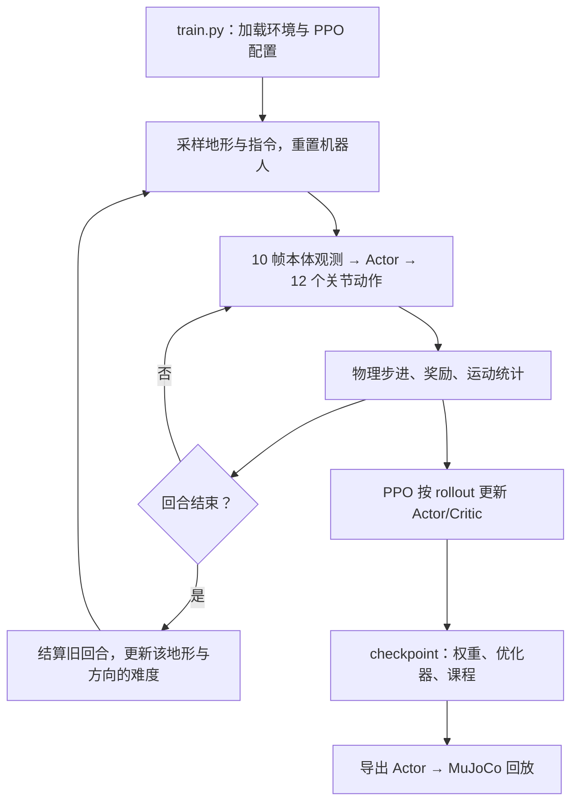

# BPX 四足机器人：多策略训练、跨仿真验证与实机对齐

项目覆盖 Isaac Lab 训练、MuJoCo 跨仿真验证（sim2sim）和基于官方 SDK 的实机接入（sim2real）。实机阶段先通过只读窗口核对关节反馈、Stand/Walk 策略输出与四元数姿态，运动入口默认关闭。

| 当前要做的事 | 文档入口 |
| --- | --- |
| 理解当前上下楼梯工程、从零训练和续训 | [楼梯训练说明](STAIRS_TRAINING.md) |
| 在 MuJoCo 中回放上下楼梯策略 | [楼梯 sim2sim](sim2sim/STAIRS_SIM2SIM.md) |
| 开始实机接入，安装依赖和配置窗口 | [sim2real 使用说明](sim2real/README.md) |
| 看懂窗口、三个 q、姿态和策略输出，排查问题 | [窗口图解使用与问题分析](sim2real/WINDOW_GUIDE.md) |
| 按步骤完成网络、初始化、录制与部署准备 | [sim2real 操作手册](sim2real/OPERATION_GUIDE.md) |
| 检查硬件接入条件 | [硬件接入说明](sim2real/HARDWARE_SETUP.md) |
| 在 MuJoCo 中验证多策略与 PD 起身 | [sim2sim 使用说明](sim2sim/README.md) |

仿真与实机共用的策略推理、历史观测和动作混合位于 `bpx_runtime/`。只读窗口使用官方关节与 IMU 默认坐标，不要求先逐关节手工测量零位、offset 和方向；发现实际不一致时再核对并添加坐标覆盖。

本项目基于 Isaac Lab 的管理器式强化学习环境，使用 RSL-RL 的 PPO 算法分别训练 BPX 四足机器人的行走、静止站立和趴卧起身策略，并将导出的策略部署到 MuJoCo，验证不同物理引擎中的控制表现（sim2sim）。项目现有环境说明以 Isaac Lab 2.2.1 为基线。

`PD_Init` 分支在 MuJoCo 中默认使用“足端五次轨迹 + 解析 IK + 关节 PD”完成趴卧起身，再交接给站立和行走策略；默认起身不需要 Init 神经网络模型。原有 RL Init 训练任务和部署入口保留，用于对照实验。

行走、站立、RL 起身三类策略共享机器人模型和 12 维动作接口；行走基线与 Init 使用 48 维单帧观测；站立任务及崎岖行走历史任务使用 H=10、Actor 450 维 / Critic 480 维的非对称历史观测。行走和站立分别提供平地与崎岖地形训练任务。MuJoCo 端通过上层状态机（Supervisor）选择策略，支持手柄速度指令、起身触发、停止过渡、动作平滑、CSV 日志记录，以及实时速度追踪和 12 关节力矩窗口。

## 任务与功能

| Gym 任务名称 | 训练目标 | 回合时长 | 默认训练迭代数 | 日志目录 |
| --- | --- | --- | --- | --- |
| `BPX-Locomotion-v0` | 平地前后、横向移动及偏航速度跟踪 | 20 秒 | 1500 | `logs/rsl_rl/bpx_locomotion/` |
| `BPX-Locomotion-Rough-v0` | 平台复位、课程起伏地形上的盲走 | 20 秒（含边界截断） | 1500 | `logs/rsl_rl/bpx_rough/` |
| `BPX-Locomotion-Rough-History-v0` | H=10 非对称观测历史的崎岖盲走 | 20 秒（含边界截断） | 1500 | `logs/rsl_rl/bpx_rough_history_asymmetric/` |
| `BPX-Locomotion-Stairs-History-v0` | 上楼/下楼/平地混合；楼梯仅前进和后退 | 最多 40 秒 | 10000 | `logs/rsl_rl/bpx_stairs_history/` |
| `BPX-Stand-v0` | 零速度指令下保持稳定站姿 | 15 秒 | 1500 | `logs/rsl_rl/bpx_stand/` |
| `BPX-Stand-Rough-v0` | 崎岖区域复位、站稳课程训练 | 15 秒 | 1500 | `logs/rsl_rl/bpx_rough_stand/` |
| `BPX-Init-v0` | 从腹部朝地的趴卧状态起身并保持站立 | 4 秒 | 3000 | `logs/rsl_rl/bpx_init/` |
| `BPX-Test-v0` | 行走任务的兼容入口 | 20 秒 | 1500 | `logs/rsl_rl/bpx_flat/` |

行走任务的指令范围为 `vx ∈ [-1.0, 1.0] m/s`、`vy ∈ [-0.5, 0.5] m/s`、`wz ∈ [-1.0, 1.0] rad/s`。平地行走按静止、纯旋转和混合运动分层采样，崎岖行走的三个速度分量独立均匀采样。站立和起身任务的三个指令分量始终为零。

Init 针对腹部朝地、机身接近水平的趴姿训练，不覆盖侧翻或仰翻后的翻身恢复。原有任务使用平地场景；新增 Rough 任务使用课程起伏地形。

历史版本的训练、观测布局和部署步骤见 [H=10 使用说明](ROUGH_HISTORY_TRAINING.md)。Actor 使用 450 维观测，Critic 使用 480 维观测，只有 Critic 接收基座线速度真值；旧的 48 维或对称 480 维 Actor checkpoint 不能直接恢复到该任务。

## 当前上下楼梯工程怎么读

当前训练的是**一个统一的行走策略**，同时覆盖上楼、下楼和平地。上楼/下楼由场地的高低方向决定；前进/后退由机身坐标系 `vx` 的正负决定，因此“后退上楼”和“前进下楼”是不同任务。Actor 只读取本体观测和指令历史，不读取地形高度或类别。

从 [bpx_stairs_history_env_cfg.py](source/BPX_test/BPX_test/tasks/manager_based/bpx_test/bpx_stairs_history_env_cfg.py) 开始阅读：它把场景、指令、观测、奖励、终止条件和课程装配成一个环境。下面的路径均相对项目根目录。

| 文件 | 负责什么 | 什么时候修改 |
| --- | --- | --- |
| `source/BPX_test/BPX_test/tasks/manager_based/bpx_test/bpx_stairs_history_env_cfg.py` | 楼梯任务总配置，450/480 维历史观测、奖励权重、地形与门槛 | 调整任务目标和训练参数 |
| 同目录 `mdp/mixed_stairs_commands.py` | 每回合选择上楼/下楼/平地及前进/后退，生成速度指令 | 调整采样比例和速度范围 |
| 同目录 `mdp/mixed_stairs_curriculum.py` | 累计实际运动、判断落稳和跟踪、独立升降级、保存课程状态 | 调整成功判定或课程升级 |
| 同目录 `mdp/stairs_rewards.py` | 长时间悬脚、长时间支撑、踢台阶惩罚 | 调整足端行为约束 |
| 同目录 `stairs_terrain_geometry.py` | 分级下楼台阶；上楼直接使用 Isaac Lab 原生倒金字塔 | 修改下楼台阶高度分布 |
| 同目录 `agents/bpx_stairs_history_ppo_cfg.py` | PPO：48 步 rollout、初始学习率 3e-4、自适应调节 | 调整优化过程 |
| `scripts/rsl_rl/train.py`、`curriculum_runner.py` | 启动 PPO、微调，以及模型/优化器/课程保存恢复 | 修改训练入口和续训行为 |
| `scripts/test_mixed_stairs_curriculum.py` | 无需启动 Isaac Sim 的采样、课程、奖励和接口测试 | 修改训练逻辑后先运行 |
| `scripts/validate_stairs_task.py` | 真实仿真、权重加载、两次 PPO 更新和恢复验证 | 修改环境装配后运行 |
| `sim2sim/config/bpx_stairs_history.toml` | MuJoCo 场景及模型路径 | 回放导出策略；不控制训练 |



课程有三条独立的进度：

- **地形难度**：8 级；上楼/下楼的前进和后退分别保存等级，连续两次成功升级、两次未完成降级。
- **楼梯方向**：stage 0 仅前进；满足成功率门槛后进入 stage 1，前进/后退各 50%。楼梯不采样侧走或转弯，平地仍保留全方向。
- **地形采样比例**：初始上楼/下楼/平地为 30/30/40%；平地移动和站立质量达标后变成 40/40/20%。这是回合数比例，不是仿真步数比例。

楼梯到外圈平台并连续落稳 0.4 秒结束；平地稳定 1 秒只作为质量条件，继续训练到边界或 40 秒时限；物理失败也会结束回合。成功还要通过实际速度跟踪检查，原地不转不能通过纯旋转指令。

最短的从零训练入口（先激活本机 Isaac Lab 环境）：

```bash
python scripts/rsl_rl/train.py --task BPX-Locomotion-Stairs-History-v0 \
  --num_envs 512 --max_iterations 10000 --headless
```

`--finetune /path/to/model.pt` 复用相同接口的权重，重新建立优化器和课程；`--resume --checkpoint /path/to/model.pt` 恢复新版楼梯训练状态，须保持环境数和统计窗口一致。旧课程使用 `--finetune`。详细的速度、地形、成功判据、曲线解释和命令见 [楼梯训练说明](STAIRS_TRAINING.md)。

本次整理已将旧的 `mdp/stairs_commands.py`、`mdp/stairs_curriculum.py` 中仍需使用的逻辑合并至 `mixed_stairs_*`，删除停用的单独上楼/侧走/转弯课程。旧 `scripts/test_stairs_curriculum.py` 的奖励和接口检查已合并至当前测试入口。保留 `rough_curriculum.py` 等公共依赖、其他任务、模型与实验记录。

## 项目结构

```text
BPX_test/
├── source/BPX_test/                 # 可编辑安装的 Isaac Lab 扩展包
│   ├── config/extension.toml        # 扩展元数据
│   └── BPX_test/
│       ├── BPX_structure/           # URDF、USD、MJCF 与网格资产
│       └── tasks/manager_based/bpx_test/
│           ├── bpx_base_env_cfg.py  # 公共机器人、场景、观测与动作
│           ├── bpx_locomotion_env_cfg.py
│           ├── bpx_stairs_history_env_cfg.py # 上下楼梯混合训练总配置
│           ├── stairs_terrain_geometry.py # 下楼分级台阶
│           ├── bpx_rough_env_cfg.py # 崎岖行走与地形配置
│           ├── bpx_rough_stand_env_cfg.py # 崎岖站立与站稳课程
│           ├── rough_terrain_geometry.py # 起伏地形网格生成
│           ├── bpx_stand_env_cfg.py
│           ├── bpx_init_env_cfg.py
│           ├── agents/             # 各任务的 PPO 配置
│           └── mdp/                # 自定义奖励、指令采样与课程
├── scripts/
│   ├── list_envs.py                 # 列出已注册的 BPX 任务
│   ├── zero_agent.py               # 零动作环境检查
│   ├── random_agent.py             # 随机动作环境检查
│   ├── test_mixed_stairs_curriculum.py # 楼梯 CPU 回归测试
│   ├── validate_stairs_task.py      # 楼梯真实仿真和 PPO 验证
│   ├── validate_rough_task.py       # 崎岖行走配置与课程验证
│   ├── validate_rough_stand_task.py # 崎岖站立重置、奖励与课程验证
│   └── rsl_rl/                     # 训练、回放与策略导出
├── sim2sim/
│   ├── config/bpx_stairs_history.toml # 上下楼梯回放
│   ├── config/bpx_flat.toml         # 平地、趴姿起身流程
│   ├── config/bpx_terrain.toml      # 三级地形、趴姿起身流程
│   ├── config/bpx_terrain_standing.toml # 三级地形、站姿直接测试
│   ├── config/bpx_terrain_history.toml # 三级地形、H=10 历史观测趴姿起步
│   ├── bpx_sim2sim/                # MuJoCo 运行器、策略与手柄接口
│   ├── run_mujoco.py               # 跨仿真运行入口
│   ├── validate_setup.py           # 模型、关节映射与 PD 检查
│   └── validate_policy_export.py   # ONNX / TorchScript 输出对比
├── bpx_runtime/                    # 仿真与实机共用的策略、关节和历史观测
├── sim2real/
│   ├── visualize.py                # 只读反馈、策略预览和姿态窗口
│   ├── run.py                      # 检查、采集、分析、回放和部署入口
│   ├── bpx_sim2real/               # SDK 适配、坐标转换、窗口和实机执行
│   ├── config/                     # 模板及本机 runtime / 坐标配置
│   ├── docs/window_guide/          # 窗口截图、标注图与 SVG 示意图
│   ├── WINDOW_GUIDE.md             # 图解阅读与问题分析
│   ├── OPERATION_GUIDE.md          # 实机操作流程
│   └── HARDWARE_SETUP.md           # 硬件接入条件
├── logs/rsl_rl/                    # 训练生成的检查点、参数与导出模型
└── outputs/                        # 运行生成的输出
```

## 环境准备

以下命令均在项目根目录执行。训练和回放使用已安装 Isaac Lab、Isaac Sim 及 RSL-RL 的 Python 环境；MuJoCo 推理可以使用独立环境。

新机器（或新建环境）安装完成后，可先运行依赖自检脚本定位缺失项，再按下列小节补齐：

```bash
python scripts/check_dependencies.py                # 检查训练环境（默认）
python scripts/check_dependencies.py --mode sim2sim # 检查 MuJoCo 推理环境
```

快速检查包含训练 Python、Isaac Lab/Sim 模块路径、RSL-RL 接口版本、USD 文件、驱动查询和实际 CUDA 运算。失败返回 `1`，通过返回 `0`。它不启动仿真；要判断当前楼梯任务是否能真正进入训练，可执行：

```bash
conda activate isaaclab
python scripts/check_dependencies.py --smoke-test
```

`--smoke-test` 默认使用楼梯任务、`cuda:0`、4 个环境，调用真实训练入口执行两轮 PPO，并核对最终 checkpoint。可用 `--task BPX-Stand-v0`、`--device cuda:1`、`--num-envs 4`、`--timeout 1200` 调整。日志和模型存入独立的 `outputs/training_env_check/check_*/`，正式训练日志不受影响。首次启动可能需要下载仿真扩展；请先按 Isaac Sim 提示完成首次许可接受。

一键补齐**当前已激活的 Isaac Lab 环境**中的训练工具、RSL-RL 和本项目扩展：

```bash
bash scripts/install_training_deps.sh --dry-run  # 可选：预览命令
bash scripts/install_training_deps.sh
# 安装后同时验证真实训练链路
bash scripts/install_training_deps.sh --smoke-test
```

新机器尚未安装 Isaac Lab/Sim 时，先准备 Python 3.11 独立环境，再使用完整安装模式：

```bash
conda create -n bpx-training python=3.11 -y
conda activate bpx-training
bash scripts/install_training_deps.sh --full
python scripts/check_dependencies.py --smoke-test
```

完整模式按 [Isaac Lab v2.2.1 官方安装说明](https://isaac-sim.github.io/IsaacLab/v2.2.1/source/setup/installation/pip_installation.html) 固定使用 Isaac Sim 5.0.0、PyTorch 2.7.0 CUDA 12.8、torchvision 0.22.0 和 RSL-RL 2.3.3。默认将 Lab v2.2.1 源码克隆至 `.deps/IsaacLab-2.2.1`；也可通过 `--isaaclab /path/to/IsaacLab` 或 `ISAACLAB_PATH` 复用 v2.2.1 源码，通过 `--python /path/to/python` 指定安装目标。完整模式需要 Linux x86_64，下载量与磁盘占用较大。

脚本只安装 Python 训练依赖；NVIDIA 驱动及完整 BPX USD 资产需自行准备。最终检查若发现驱动、CUDA 或资产问题仍返回非零退出码，并给出原因。现有二进制 Sim 安装应先正常激活其 Conda 环境，使 Sim/torch 的 `PYTHONPATH` 和动态库路径生效，再用默认补齐模式。

### 安装训练扩展

将本项目放在 Isaac Lab 安装目录之外，并在 Isaac Lab 对应环境中执行：

```bash
python -m pip install -e source/BPX_test
python scripts/list_envs.py
```

`list_envs.py` 应列出上表中的八个任务。项目安装脚本不会自动安装完整的 Isaac Lab / Isaac Sim 运行环境；若使用 Isaac Lab 自带的启动脚本，可将命令中的 `python` 替换为 `/path/to/IsaacLab/isaaclab.sh -p`。

**首次克隆后请检查机器人资产。** 训练需要 `source/BPX_test/BPX_test/BPX_structure/usd/bpx.usd` 及其引用的 USD 文件。仓库的 `.gitignore` 忽略了 USD 文件，因此仅克隆代码可能缺少这些资产。需要复制完整 USD 资产，或使用 Isaac Lab 的 URDF 转换工具，参照 [转换配置](source/BPX_test/BPX_test/BPX_structure/usd/config.yaml) 从 `BPX_structure/bpx/urdf/bpx.urdf` 重新生成；保留足端固定关节对应的独立刚体，并保持转换参数与训练配置一致。

### 安装 MuJoCo 推理环境

sim2sim 配置读取使用 Python 标准库 `tomllib`，因此该环境需要 Python 3.11 或更高版本。使用 Conda 时可执行：

```bash
conda create -n bpx-sim2sim python=3.11 -y
conda activate bpx-sim2sim
python -m pip install -r sim2sim/requirements.txt
python sim2sim/validate_setup.py
```

依赖包括 NumPy、MuJoCo 和 ONNX Runtime。仅使用 ONNX 推理无需安装 PyTorch；使用 TorchScript 或导出一致性检查时，还需要在该环境中安装 `torch`。

### 实机只读窗口

按 [sim2real 使用说明](sim2real/README.md) 准备 Python 3.11+、官方 SDK、ONNX Runtime 和本机配置后，在项目根目录执行：

```bash
conda activate bpx-real
python sim2real/visualize.py

# 不连接机器人，使用模拟反馈熟悉界面
python sim2real/visualize.py --demo
```

窗口优先使用 `sim2real/config/local.runtime.toml`，不存在时使用模板。插好网线并按厂商流程上电和初始化后，填写机器人 IP，点击“连接只读反馈”。Wi-Fi 可继续用于上网，路由配置见 [操作手册](sim2real/OPERATION_GUIDE.md)。

窗口显示 12 个关节的反馈和预览目标、自动选中策略的原始 action、姿态骨架与参数对照，默认字号 32，可调到 48。电脑 USB/蓝牙手柄输入以只读方式显示，与部署共用的状态机自动选择 Stand/Walk/STOPPING，不提供手动策略或速度输入。预览目标不发送给机器人，“目标−反馈”不是闭环跟踪误差。标注截图和完整分析方法见 [窗口图解手册](sim2real/WINDOW_GUIDE.md)；DEMO 使用模拟反馈，不能证明实机已对齐。

DEMO 中青色骨架来自程序生成的反馈：关节只在默认站姿附近摆动约 ±2°，机身缓慢旋转，绘图位置固定。橙色骨架表示模型目标，目标不会驱动青色反馈，因此 Walk 预览不会显示实际迈腿行走。可观察“当前 q”和 RPY 数值确认刷新；详细说明见 [sim2real README](sim2real/README.md#demo-中青色骨架为什么看起来不动)。验证策略执行后的步态请使用 [MuJoCo sim2sim](sim2sim/README.md)。

实机运动当前仅保留有限数/四元数模长 [0.5,1.5] 检查，以及退出尝试 kp=0、kd=1 阻尼。执行 `python sim2real/run.py --config sim2real/config/local.runtime.toml run --live --gamepad-index 0`，日志自动创建；详细流程见 [实机操作手册](sim2real/OPERATION_GUIDE.md#6-实机运动)。

## 训练、回放与导出

本节命令在 Isaac Lab 环境中执行。

### 检查环境并开始训练

可先用少量环境检查资产加载和训练流程：

```bash
# 零动作检查：动作零点对应默认站姿
python scripts/zero_agent.py --task BPX-Stand-v0 --num_envs 4

# 随机动作检查
python scripts/random_agent.py --task BPX-Locomotion-v0 --num_envs 4

# 短训练检查：验证训练循环、日志和检查点保存
python scripts/rsl_rl/train.py \
    --task BPX-Locomotion-v0 --num_envs 64 --max_iterations 2 --headless
```

按需训练行走和站立策略；只有使用 RL Init 对照流程时才需要训练起身策略：

```bash
python scripts/rsl_rl/train.py --task BPX-Locomotion-v0 --headless
python scripts/rsl_rl/train.py --task BPX-Stand-v0 --headless
python scripts/rsl_rl/train.py --task BPX-Init-v0 --headless
```

默认并行环境数为 2048，可通过 `--num_envs 512` 等参数降低显存占用。训练默认使用三层 `[128, 128, 128]` 的 ELU 网络，普通任务每个环境每轮采集 24 步（楼梯为 48 步），每 50 次迭代保存一次检查点；`--max_iterations` 可覆盖任务的默认迭代数。

常用参数还包括 `--seed`、`--run_name`、`--experiment_name` 和 `--logger`。训练结果保存在 `logs/rsl_rl/<实验名>/<时间戳>[_运行名]/`，其中 `params/` 记录本次运行的环境和算法配置。

恢复训练时，将下列运行目录和检查点文件名替换为实际值：

```bash
python scripts/rsl_rl/train.py \
    --task BPX-Locomotion-v0 --headless --resume \
    --load_run "<运行目录名>" --checkpoint "model_<迭代编号>.pt"
```

### 从平地策略微调崎岖地形策略

崎岖行走和站立任务均采用 ±0.5～±4 cm 的 8 级起伏地形和 12 维动作接口，不向策略输入地形高度。普通崎岖行走使用 48 维单帧观测；崎岖站立与历史版崎岖行走使用 H=10 非对称历史观测。

| 任务 | 重置位置 | 难度课程 | 奖励 |
| --- | --- | --- | --- |
| `BPX-Locomotion-Rough-v0` | 中央 2×2 m 平地 | 根据崎岖区域通过距离、停留时间和速度跟踪表现升降级 | 沿用平地行走奖励 |
| `BPX-Stand-Rough-v0` | 25% 平地、50% 当前等级、25% 低等级回放；其中 25% 使用切换状态分布 | 当前等级样本连续站稳两回合升级，失败降级；成功要求四足接触率 ≥90%、左右对称率 ≥80% | 相对地面高度与带死区的左右镜像约束 |

站立每回合 15 秒，排除前 0.5 秒落脚期后，稳定时间占比和四足同时接触占比均须达到 90%；reset 会扰动机身姿态、初速度、关节位置及关节速度。平地和低等级回放样本不参与升级。地面高度查询仅用于仿真重置与奖励，不增加策略观测或实机传感器需求。

以下为本机已有平地检查点的微调示例；其他机器需替换为实际文件路径：

```bash
# 崎岖行走
python scripts/rsl_rl/train.py \
    --task BPX-Locomotion-Rough-v0 --num_envs 512 --headless --resume \
    --checkpoint logs/rsl_rl/bpx_locomotion/2026-09-15_13-15-43_stable/model_4999.pt \
    --max_iterations 1500

# 崎岖站立（H=10，旧 48 维检查点不能恢复）
python scripts/rsl_rl/train.py \
    --task BPX-Stand-Rough-v0 --num_envs 512 --headless \
    --max_iterations 1500

# H=10 历史观测崎岖行走（从头训练，不能 resume 48 维检查点）
python scripts/rsl_rl/train.py \
    --task BPX-Locomotion-Rough-History-v0 --num_envs 2048 --headless
```

`--resume --checkpoint` 加载训练状态，不是导出模型；只用于输入维度相同的检查点。`--max_iterations` 表示本次训练的迭代数；新日志分别写入 `bpx_rough` 和 `bpx_rough_stand`。上述 Rough 任务不保存地形课程状态，恢复训练后课程从最低级开始；楼梯任务通过 `CurriculumOnPolicyRunner` 单独保存和恢复课程。

详细参数与评估方法见 [崎岖行走训练](ROUGH_TERRAIN_TRAINING.md) 和 [崎岖站立训练](ROUGH_STAND_TRAINING.md)。需要检查实现时可运行：

```bash
python -u scripts/validate_rough_task.py --headless
python -u scripts/validate_rough_stand_task.py --headless
```

### 查看训练曲线

```bash
tensorboard --logdir logs/rsl_rl
```

在浏览器打开终端显示的地址，通常为 `http://localhost:6006`。结合任务奖励、回合长度、动作平滑程度和仿真回放判断策略效果；短训练检查仅用于验证流程。曲线含义见 [训练曲线说明](RL_TRAINING_CURVES.md)。

### 回放并导出策略

```bash
# 按默认加载规则选择检查点，使用一个机器人实时回放
python scripts/rsl_rl/play.py \
    --task BPX-Locomotion-v0 --num_envs 1 --real-time

# 指定检查点；请替换为实际文件路径
python scripts/rsl_rl/play.py \
    --task BPX-Locomotion-v0 --num_envs 1 \
    --checkpoint "logs/rsl_rl/bpx_locomotion/<运行目录>/model_<迭代编号>.pt"
```

`play.py` 加载检查点后会自动在该检查点所在目录下生成：

```text
exported/
├── policy.pt      # TorchScript 推理模型
└── policy.onnx    # ONNX 推理模型
```

站立和起身策略采用相同流程，分别使用 `BPX-Stand-v0`、`BPX-Init-v0` 及其对应检查点。崎岖策略应选择对应的 Rough 任务，例如：

```bash
python scripts/rsl_rl/play.py \
    --task BPX-Stand-Rough-v0 --num_envs 4 \
    --checkpoint "logs/rsl_rl/bpx_rough_stand/<运行目录>/model_<迭代编号>.pt"
```

崎岖行走使用 `BPX-Locomotion-Rough-v0` 和 `bpx_rough` 目录下的检查点。

训练检查点 `model_*.pt` 与导出的 `policy.pt` 用途不同，MuJoCo 端加载导出模型。

## MuJoCo 跨仿真运行

本节命令在 MuJoCo 推理环境中执行。

### 配置模型路径

根据运行流程选择配置；各 TOML 相互独立，不会继承或同步策略路径：

| 配置 | 地形 / 初始姿态 | 用途 |
| --- | --- | --- |
| [bpx_flat.toml](sim2sim/config/bpx_flat.toml) | 平地 / 趴姿 | 平地手柄起身与多策略测试 |
| [bpx_terrain.toml](sim2sim/config/bpx_terrain.toml) | 三级起伏地形 / 趴姿 | 手柄 RB 起身、崎岖行走与站立切换 |
| [bpx_terrain_standing.toml](sim2sim/config/bpx_terrain_standing.toml) | 三级起伏地形 / 站姿 | 直接测试行走策略；文件名中的 standing 指初始姿态 |
| [bpx_terrain_history.toml](sim2sim/config/bpx_terrain_history.toml) | 三级起伏地形 / 趴姿 | H=10 历史观测行走和崎岖站立策略验证，配合 `--supervisor --auto-init` 无手柄起身 |
| [bpx_stairs_history.toml](sim2sim/config/bpx_stairs_history.toml) | 六级 15 cm 实体楼梯、20 cm 踏面 / 趴姿 | PD 起身后接楼梯历史策略，经过 90 cm 顶平台再下楼；见[运行说明](sim2sim/STAIRS_SIM2SIM.md) |

编辑实际传给 `--config` 的文件的 `[paths]`，将 `locomotion_policy`、`stand_policy` 指向各自导出的 `policy.onnx`；使用 TorchScript 时同时更新 `torchscript_policy`。内置配置的 `[init_controller]` 均设为 `mode = "pd"`，不会加载 `init_policy`；仅切回 RL Init 时需要该模型。

配置中的相对路径均相对于项目根目录解析。默认文件记录了具体实验目录，且 `logs/` 被 Git 忽略，因此这些检查点不保证随代码仓库提供，也不会自动切换到新训练的模型。

无需策略文件即可检查模型和 PD 控制：

```bash
python sim2sim/validate_setup.py
python sim2sim/run_mujoco.py --backend zero --duration 2 --no-realtime
```

这些命令用于检查 MJCF 加载、关节映射、观测构造与数值稳定性，不代表训练策略已通过运动性能验证。

### 手柄控制与多策略切换

配置好行走和站立 ONNX 策略后，在 Linux 上连接手柄并运行（以下使用 H=10 配置）：

```bash
python sim2sim/run_mujoco.py --list-gamepads
python sim2sim/run_mujoco.py \
    --config sim2sim/config/bpx_terrain_history.toml \
    --backend onnx --viewer --gamepad --supervisor \
    --duration 120 --log sim2sim/logs/gamepad.csv
```

默认配置从趴姿开始，运行流程如下：

1. `WAITING_INIT`：保持趴姿，等待按下手柄 **RB**。
2. `INIT`：默认执行足端轨迹和 PD 控制，速度指令保持为零；轨迹完成且满足高度、姿态、速度和四足接触的稳定确认条件后进入 `STAND`。
3. `STAND`：调用站立策略；摇杆指令持续超过阈值后进入 `WALK`。
4. `WALK`：调用行走策略跟踪速度；松开摇杆后经 `STOPPING` 减速，再回到 `STAND`。

默认左摇杆上下控制 `vx`、左右控制 `vy`，右摇杆左右控制 `wz`。可加 `--gamepad-deadman`，要求按住 **LB** 才接受非零速度指令；多个手柄可用 `--gamepad-index 0` 或 `--gamepad-device /dev/input/eventN` 选择。

Supervisor 使用指令变化率限制、切换迟滞、稳定时间确认和动作混合来平滑过渡。遇到不支持的起身姿态、起身倾角过大等条件时进入 `DISABLED`，运行器结束本次仿真。缺少站立模型时会使用零指令行走策略作为回退；PD Init 不依赖起身模型；只有 RL Init 模式缺少起身模型时，才无法完成趴姿起身流程。

### 三级地形与崎岖策略测试

测试场依次为平地、轻微起伏（±2 cm）、较大起伏（±4 cm），带区域标签和平坦返回通道。地形振幅在 [terrain.py](sim2sim/bpx_sim2sim/terrain.py) 的 `MILD_AMPLITUDE`、`MODERATE_AMPLITUDE` 修改，单位为米；高度场归一化和标签随参数调整。

使用旧版 48 维崎岖模型时可编辑 `bpx_terrain.toml`。使用 450 维历史行走模型时，选择 `bpx_terrain_history.toml`。站立 ONNX 加载器支持 48/45 维单帧和 450 维历史输入，可与单帧或历史行走模型搭配；各配置都需单独更新模型路径。旧版 48 维 Stand 检查点不能用于继续训练当前站立任务。旧版模型的运行示例：

```bash
python sim2sim/run_mujoco.py \
    --config sim2sim/config/bpx_terrain.toml \
    --backend onnx --viewer --gamepad --supervisor \
    --duration 120 --log sim2sim/logs/terrain_gamepad.csv
```

按 RB 在出生平地起身后，分别检查三个区域上的行走与站立，并测试“行走 → 停止 → 站立 → 再行走”。默认 PD Init 面向平地、机身接近水平的腹部朝地趴姿，不包含台阶落足规划或翻身恢复；崎岖行走和站立训练也不包含崎岖地形起身。

CSV 中 `base_z` 是世界高度，`ground_z` 为当地地面高度，`base_clearance` 为局部离地高度，`terrain_region` 为当前区域。具体说明见 [三级地形使用说明](sim2sim/README.md#三级起伏地形测试场)。

从站姿直接测试行走可使用现成配置，先单独更新该配置的行走模型路径：

```bash
python sim2sim/run_mujoco.py \
    --config sim2sim/config/bpx_terrain_standing.toml \
    --backend onnx --viewer --vx 0.2 --vy 0.0 --wz 0.0 --duration 50
```

### PD 起身与实时曲线

无手柄时可直接用历史策略配置自动起身，并同时观察速度和关节力矩：

```bash
python sim2sim/run_mujoco.py \
    --config sim2sim/config/bpx_terrain_history.toml \
    --backend onnx --auto-init --viewer --vx 0 --vy 0 --wz 0 \
    --velocity-plot --torque-plot --duration 30 \
    --log sim2sim/logs/pd_init.csv
```

`--auto-init` 自动启用 Supervisor；将 `--vx 0` 改为 `--vx 0.2` 可在起身后继续行走。手柄流程改用 `--supervisor --gamepad`，按 RB 起身。命令未指定 `--config` 时仍使用 `bpx_flat.toml`。

PD Init 默认先用 1 秒收脚到低位支撑，再用 3 秒抬升；足端支撑深度为 0.19 m、最终深度为 0.38 m，均为髋坐标系下的运动学距离。Init 使用 `Kp=80`、`Kd=2`、30 N·m 力矩上限及 2 rad/s 目标关节角变化率限制。跟踪误差过大或抬升阶段未保持四足接触时暂停轨迹；轨迹完成后还需连续稳定 0.5 秒，超过 8 秒未交接会以 `init_pd_timeout` 结束。因此 4 秒是标称轨迹时长，不是固定的起身完成时间。参数集中在 TOML 的 `[init_controller]`，详细说明见 [PD Init 控制流程](sim2sim/README.md#pd-init4-秒五次足端轨迹)。

`--velocity-plot` 对比机体系 `vx/vy/wz` 指令和实际值，显示误差与可见样本 RMSE；`--torque-plot` 显示 12 关节实际执行器力矩。两个窗口均支持暂停显示和导出可见 CSV，默认显示最近 10 秒，可用 `--velocity-window`、`--torque-window` 设置 1–30 秒。图表需要 Tkinter 和桌面显示环境；实时观察时保留实时限速。图表导出的物理步数据与 `--log` 的策略步日志分开。

需要对比旧 RL 起身模型时，在启用 Supervisor 的命令中加 `--init-policy /实际路径/policy.onnx`，会覆盖配置并切换到 RL Init；也可将 `[init_controller].mode` 改为 `"policy"` 并配置 `paths.init_policy`。RL Init 使用单帧输入，不复用 H=10 行走历史模型。

### 无手柄的单策略测试

默认 TOML 的初始姿态是趴姿。若要直接测试行走策略，请先复制一份配置，并将 `[initial_state]` 的 `base_position` 改为 `[0.0, 0.0, 0.40]`，将 `joint_position` 设为与 `default_joint_position` 相同的站姿：

```bash
cp sim2sim/config/bpx_flat.toml sim2sim/config/bpx_standing.toml
# 按上述说明修改 bpx_standing.toml，再运行
python sim2sim/run_mujoco.py \
    --config sim2sim/config/bpx_standing.toml \
    --backend onnx --vx 0.2 --vy 0.0 --wz 0.0 \
    --duration 10 --no-realtime --log sim2sim/logs/forward.csv
```

需要窗口时加 `--viewer`；需要按墙钟时间播放时去掉 `--no-realtime`。仅添加 `--supervisor` 不会自动触发趴姿起身：手柄流程按 RB 发起，无手柄的自动化流程可加 `--auto-init`，摔倒回到趴姿后会再次自动起身。

若要比较 ONNX 与 TorchScript 导出结果，先确认配置中的两个模型来自**同一个检查点**，再执行：

```bash
python sim2sim/validate_policy_export.py --samples 100
```

## 训练与部署的公共接口

接口定义集中在 [bpx_base_env_cfg.py](source/BPX_test/BPX_test/tasks/manager_based/bpx_test/bpx_base_env_cfg.py)，MuJoCo 端参数位于实际使用的 `sim2sim/config/*.toml`。修改接口后，需要同步训练、导出和部署配置。

| 项目 | 当前配置 |
| --- | --- |
| 物理步长 / 频率 | `0.005 s` / 200 Hz |
| 策略执行频率 | 每 4 个物理步更新一次，即 50 Hz |
| 观测 / 动作维度 | 48 / 12（H=10 历史 Actor 为 450 / 12，Critic 输入 480 维） |
| 动作含义 | `目标关节角 = 默认关节角 + 0.5 × action` |
| 默认关节角 | 髋横滚 `0.0`、髋俯仰 `0.7`、膝关节 `-1.4` rad |
| Stand/Walk 名义 PD 增益 | `Kp = 40`、`Kd = 1` |
| MuJoCo PD Init 增益 | `Kp = 80`、`Kd = 2`，进入/退出时平滑过渡 |
| 力矩 / 速度限制配置 | `30 N·m` / `20 rad/s` |

48 维观测按以下顺序拼接：

```text
机身坐标系线速度(3) + 角速度(3) + 重力投影(3)
+ 速度指令[vx, vy, wz](3)
+ 相对默认姿态的关节角(12) + 相对关节速度(12) + 上一步动作(12)
```

站立任务和崎岖行走历史任务将每个观测项按"最旧到最新"各自堆叠 10 帧后再拼接（按项分块，不是 10 个完整 48 维帧的直接相连），Actor 移除线速度后得到 450 维输入，Critic 保留线速度真值得到 480 维输入；完整布局与部署侧的历史缓存契约见 [H=10 使用说明](ROUGH_HISTORY_TRAINING.md)。

关节按“类型优先”排列：先四个髋横滚，再四个髋俯仰，最后四个膝关节；每组内部均为 `fl → fr → hl → hr`（左前、右前、左后、右后）。不要直接用 MJCF 中的关节存储顺序替代策略顺序，详见 [关节顺序映射说明](sim2sim/JOINT_ORDER_MAPPING_GUIDE.md)。

训练使用观测噪声、摩擦和执行器增益随机化；MuJoCo 推理使用无附加噪声的观测。Isaac Lab 使用隐式 PD 执行器，MuJoCo 默认逐物理步执行显式 PD，因此参数一致仍需进行跨仿真验证。MuJoCo 的 `joint_position` 决定复位姿态，`default_joint_position` 决定策略动作零点，两者含义不同。

## 常见问题

| 现象 | 检查方法 |
| --- | --- |
| 无法导入 `isaaclab` 或 `BPX_test` | 确认当前解释器属于 Isaac Lab 环境，并重新执行可编辑安装 |
| 找不到 `bpx.usd` 或引用资产 | 检查完整 USD 资产是否已复制或转换生成；USD 文件被 Git 忽略 |
| 训练显存不足 | 降低 `--num_envs`，并使用 `--headless` |
| MuJoCo 找不到策略文件 | 更新 TOML 的 `[paths]`，检查是否已通过 `play.py` 导出模型 |
| 趴姿一直等待、不起身 | 确认已启用 Supervisor；手柄流程按 RB，无手柄加 `--auto-init`；只有 RL Init 模式需要检查起身模型 |
| ONNX / TorchScript 对比失败 | 先确认两份导出来自同一检查点；默认配置可能指向不同实验 |
| 实机窗口无反馈、策略列为空或姿态方向不对 | 按 [窗口图解手册](sim2real/WINDOW_GUIDE.md) 检查连接、反馈新鲜度、模型和坐标转换 |
| 编辑器无法解析 Isaac Sim 模块 | 在 VS Code 中运行 `setup_python_env` 任务，按提示填写 Isaac Sim 安装路径 |

## 开发与参考文档

修改任务目标时，优先调整对应的 `bpx_*_env_cfg.py`、`agents/` 和 `mdp/`；修改公共观测、动作或关节顺序时，需要同时检查三个策略和 sim2sim 的兼容性。

仓库提供 pre-commit 配置，可手动运行格式检查：

```bash
python -m pip install pre-commit
pre-commit run --all-files
```

- [上下楼梯混合训练与工程说明](STAIRS_TRAINING.md)
- [上下楼梯 MuJoCo 回放](sim2sim/STAIRS_SIM2SIM.md)
- [崎岖行走课程与微调](ROUGH_TERRAIN_TRAINING.md)
- [H=10 历史观测使用说明](ROUGH_HISTORY_TRAINING.md)
- [崎岖站立课程与历史观测训练](ROUGH_STAND_TRAINING.md)
- [训练—导出—MuJoCo 工作流](sim2sim/BPX_SIM2SIM_WORKFLOW.md)
- [MuJoCo 运行器与手柄使用说明](sim2sim/README.md)
- [sim2real 使用说明](sim2real/README.md)
- [实机窗口图解与问题分析](sim2real/WINDOW_GUIDE.md)
- [实机操作手册](sim2real/OPERATION_GUIDE.md)
- [硬件接入说明](sim2real/HARDWARE_SETUP.md)
- [训练环境配置说明](BPX_ENV_SETUP.md)
- [强化学习训练曲线说明](RL_TRAINING_CURVES.md)
- [行走策略改进路线](BPX_IMPROVEMENT_ROADMAP.md)
- [行走控制参考资料](BPX_LOCOMOTION_LITERATURE.md)
- [项目交互式思维导图](BPX_PROJECT_MINDMAP.html)

# TODO
- [ ] 尝试使用HIMloco框架实现对比差距
- [ ] 参考RMA论文尝试历史信息编码器
- [ ] 完善域随机化（视sim2real情况）
