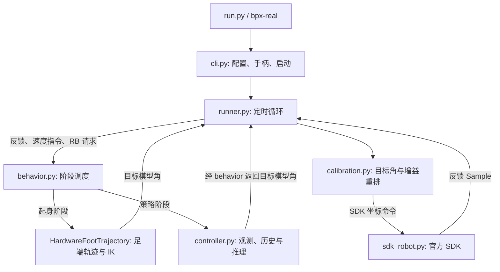

# sim2real 文件结构与职责说明

本文对应当前拆分后的代码结构，说明实机部署、调试工具、公共运行库及配置文件各自的职责。操作步骤见 [操作手册](OPERATION_GUIDE.md)，窗口使用见 [窗口图解](WINDOW_GUIDE.md)，常用入口见 [README](README.md)。

## 1. 目录结构

```text
sim2real/
├── run.py                            # 实机部署入口
├── visualize.py                      # 只读窗口快捷入口
├── bpx_sim2real/                      # 实机部署包
│   ├── __init__.py                    # 包初始化与源码导入路径
│   ├── cli.py                         # 参数、资源检查、手柄和启动
│   ├── config.py                      # 配置加载与校验
│   ├── runner.py                      # 定时控制循环
│   ├── behavior.py                    # 起身、策略接管与阶段调度
│   ├── controller.py                  # 观测、历史、推理和目标角生成
│   ├── calibration.py                 # 关节顺序与坐标转换
│   ├── sdk_robot.py                   # 官方 SDK 连接、反馈与命令发送
│   ├── state.py                       # 统一反馈结构 Sample
│   └── safety.py                      # 资源及数值有效性检查
├── tools/                            # 独立调试工具
│   ├── run.py                         # 工具命令行入口
│   └── bpx_sim2real_tools/
│       ├── __init__.py                # 工具包初始化与源码导入路径
│       ├── cli.py                     # 工具参数与命令分发
│       ├── monitor.py                 # 窗口和后台数据线程
│       ├── diagnostics.py             # 姿态、坐标对照和策略预览
│       ├── monitor_input.py           # 窗口专用手柄读取与重试
│       ├── capture.py                 # 无窗口只读采集
│       ├── recording.py               # 录制读取、重采样与统计
│       └── replay.py                  # 离线策略推理
├── config/
│   ├── runtime.toml                   # 通用运行模板
│   ├── local.runtime.toml             # 本机运行配置，可选且不提交 Git
│   ├── joint_calibration.template.toml # 通用坐标配置模板
│   └── local.calibration.toml         # 本机坐标配置，可选且不提交 Git
├── tests/
│   ├── test_runtime.py                # 部署、SDK、坐标和回放回归
│   ├── test_behavior.py               # 起身与行为流程回归
│   ├── test_diagnostics.py            # 窗口诊断与预览回归
│   └── test_separation.py             # 部署/工具边界及入口回归
├── docs/window_guide/                 # 截图、标注图和示例数据
├── README.md                          # 常用命令与文档入口
├── FILE_STRUCTURE.md                  # 本文：文件职责与调用关系
├── OPERATION_GUIDE.md                 # 环境、联网及实机操作步骤
├── WINDOW_GUIDE.md                    # 窗口阅读与问题分析
└── HARDWARE_SETUP.md                  # 硬件接入说明和记录
```

项目根目录的 [`bpx_runtime/`](../bpx_runtime/) 提供公共算法和 JSONL 写入器；根目录的 [`pyproject.toml`](../pyproject.toml) 配置包安装、依赖和命令行入口。`__pycache__/` 是 Python 自动生成的缓存，不属于手写控制逻辑。

## 2. 启动入口与依赖边界

| 入口文件 | 对应安装命令 | 职责 |
| --- | --- | --- |
| [run.py](run.py) | `bpx-real` | 启动部署 CLI，执行 `check` 或 `run`；旧调试子命令按需转发。 |
| [visualize.py](visualize.py) | `bpx-monitor` | 直接启动只读窗口，支持实机反馈、DEMO 和录制播放。 |
| [tools/run.py](tools/run.py) | `bpx-real-tools` | 启动独立工具 CLI，执行 `monitor / inspect / analyze / replay`。 |

入口脚本只负责找到实现并调用 `main()`，具体逻辑在包内。

- 部署包复用公共运行库，执行 `check / run` 时不加载工具包或 Tkinter。
- 工具包复用部署的配置、坐标转换、反馈结构、SDK 适配和 Actor 控制器。
- 部署日志与调试录制共用 `bpx_runtime/jsonl.py`，部署不依赖工具的录制读取、统计或回放实现。
- `run.py monitor/inspect/analyze/replay ...` 仍可用，只有选中这些命令时才加载工具包。
- 官方 `bpx_sdk` 在创建 `SDKSource` 时加载；资源检查和离线推理不创建硬件连接。

`visualize.py` 默认优先选择本机 `local.runtime.toml`；部署 CLI 和工具 CLI 默认选择模板 `runtime.toml`。使用本机参数时可显式传入 `--config`。

## 3. 实机部署文件

以下文件位于 `bpx_sim2real/`。

| 文件 | 主要对象/函数 | 职责 |
| --- | --- | --- |
| [cli.py](bpx_sim2real/cli.py) | `parser()`、`check()`、`main()`、`run_tool()` | 解析参数、加载配置、检查依赖和模型路径/哈希、选择手柄、创建日志路径并启动部署循环；按需转发旧工具命令。 |
| [config.py](bpx_sim2real/config.py) | `Config`、`JointCalibration`、`HardwareInitConfig`、`load_config()` | 读取运行和坐标 TOML，解析相对路径，校验网络、策略契约、关节映射、增益和起身时序，提供统一配置对象。 |
| [runner.py](bpx_sim2real/runner.py) | `wait_for_feedback()`、`run_live()` | 等待完整反馈，按时读取状态和手柄、调用行为控制器、转换并发送目标、写日志，以及管理持续运行或定时结束。 |
| [behavior.py](bpx_sim2real/behavior.py) | `HardwareFootTrajectory`、`HardwareController` | 生成起身轨迹，管理等待起身、起身和策略运行阶段，选择目标角及增益，衔接策略接管。 |
| [controller.py](bpx_sim2real/controller.py) | `ActorController` | 构造观测与历史，调用 Stand/Walk 路由和 ONNX 模型，混合动作、生成目标角并处理接管过渡，维护下一周期的上一动作。 |
| [calibration.py](bpx_sim2real/calibration.py) | `Calibration` | 双向转换关节顺序、方向和偏置，重排增益，转换 IMU 坐标并计算机体系重力方向和角速度。 |
| [sdk_robot.py](bpx_sim2real/sdk_robot.py) | `SDKSource` | 创建官方 SDK 对象、配置网络、建立连接、读取普通/高频反馈、发送完整关节命令，退出时尝试阻尼并断开。 |
| [state.py](bpx_sim2real/state.py) | `Sample` | 定义反馈容器，统一保存关节、IMU、时间标记、数据年龄、连接状态、身份和遥测信息，支持字典序列化。 |
| [safety.py](bpx_sim2real/safety.py) | `require_ready()`、`quaternion_xyzw()`、`StateGuard` | 检查模型资源、反馈数组尺寸、有限数和四元数模长。当前不实现关节限幅、反馈过期或倾角停机。 |
| [__init__.py](bpx_sim2real/__init__.py) | 包初始化 | 将项目根目录加入源码导入路径，使直接运行脚本时能找到公共运行库。 |

### 3.1 runner、behavior、controller 的区别

| 文件 | 负责的问题 | 产生的结果 |
| --- | --- | --- |
| `runner.py` | 什么时候读取、什么时候计算、什么时候发送？ | 按时执行控制周期和 SDK 调用。 |
| `behavior.py` | 当前应该保持姿态、起身，还是运行策略？ | 当前模式、目标关节角及 `kp/kd`。 |
| `controller.py` | 运行策略时，下一组目标关节角是多少？ | 观测、模型动作、处理后的目标角和策略模式。 |

### 3.2 behavior.py 不只管理起身

`HardwareFootTrajectory` 专门生成起身目标：捕获实测关节姿态，通过正运动学得到当前足端位置，沿五次轨迹收脚到支撑点并抬升，再通过逆运动学得到关节角。

`HardwareController` 负责外围阶段调度：

1. 启动时读取固件运动状态：`motion_state == 6` 时直接进入 Stand，否则等待 RB 起身请求。
2. 等待阶段保持启动时捕获的实测关节角，不执行 Stand/Walk 策略推理。
3. 收到起身请求后启动轨迹，并平滑切换到起身增益。
4. 起身轨迹完成后接入 `ActorController`，平滑切换到策略增益。
5. 策略运行时接收 Actor 返回的 Stand/Walk/STOPPING 模式和目标角；两次策略更新之间保持目标。
6. 将已发送的最终目标交回 Actor，维护下一周期的上一动作观测。

Stand/Walk/STOPPING 的切换阈值、迟滞和延时由 [`bpx_runtime/routing.py`](../bpx_runtime/routing.py) 实现，`controller.py` 调用路由器；`behavior.py` 接收并跟随该结果。

### 3.3 calibration.py 的输入输出

这里的“标定”指使用已配置的坐标参数做转换，不执行自动标定或电机标零。

| 方法 | 输入 | 输出/用途 |
| --- | --- | --- |
| `position_from_sdk()` | SDK 顺序的实测关节角 | 策略顺序的模型角，应用方向和偏置。 |
| `velocity_from_sdk()` | SDK 顺序的实测关节速度 | 策略顺序的模型角速度，应用方向。 |
| `position_to_sdk()` | 策略顺序的模型目标角 | SDK 顺序的目标角，反向处理方向和偏置。 |
| `gains_to_sdk()` | 策略顺序的 `kp` 或 `kd` | SDK 顺序的增益，只重排，不应用方向符号。 |
| `imu()` | SDK 四元数和角速度 | 按配置转换后的机体系重力方向和角速度。 |

关节转换关系为：

```text
q_model[i] = sign[i] × q_sdk[sdk_index[i]] + offset[i]
q_sdk_target[sdk_index[i]] = sign[i] × (q_model_target[i] − offset[i])
```

其中 `sign` 只能为 `+1/-1`。策略按关节类型排列，SDK 按腿排列，因此即使方向和偏置使用默认值，也需要关节重排。

### 3.4 sdk_robot.py 的边界

| 接口 | 职责 |
| --- | --- |
| `__enter__()` | 设置 IP、状态端口和上传频率，启动连接并等待真实连接成功。 |
| `read()` | 读取 SDK 缓存，校验可用数值并整理为 `Sample`；控制模式读取高频反馈，只读模式读取普通反馈。 |
| `_group()` | 比较读取前后的更新标记，尽量避免混合不同更新批次的数据。 |
| `_age()` | 计算主机首次观察到更新标记变化后经过的时间，供诊断使用；它不是端到端网络延迟。 |
| `send()` | 校验五组 12 维数组，再调用 `setJointCommand(kp, position, kd, velocity, feedforward)`。 |
| `__exit__()` | 若已发送运动命令且连接可用，尝试退出阻尼，最后断开；阻尼失败不覆盖原始异常。 |

`joint_control=False` 创建 `RequestRobotState`，禁止发送关节命令；`joint_control=True` 创建 `JointLevelControl`。通信协议打包和传输由 SDK 完成，本文件组织 SDK 调用。

## 4. 一次实机控制周期



实机流程如下：

1. `cli.py` 加载配置、检查资源、连接手柄，调用 `run_live()`。
2. `runner.py` 创建关节控制 SDK 连接，等待首个完整 Actor 反馈，并初始化 `HardwareController`。
3. 每个发送周期读取反馈，调用 `StateGuard` 做数值检查。
4. 到达策略周期时读取速度指令和起身请求；`behavior.py` 决定使用保持目标、起身轨迹或 Actor 输出。
5. 策略阶段由 `controller.py` 转换反馈、构造观测与历史、选择模型并推理。
6. 将处理后的动作转换为目标模型角，并执行接管过渡。
7. `runner.py` 使用 `Calibration` 将目标角和增益转换为 SDK 顺序，再调用 `SDKSource.send()`。
8. 保存最终目标对应的上一动作，并写入反馈、模式、目标和策略数据日志。

当前模板配置为 50 Hz 策略更新、100 Hz 发送。策略单帧为 45 维，10 帧历史展平为 450 维；模型输出 12 维 `action`。动作经过混合后按以下关系生成目标，再从实测姿态逐渐接管：

```text
目标模型角 = 默认关节角 + action_scale × 混合后的 action
```

当前 `action_scale=0.5`。默认角和缩放属于训练契约，不应因改变起身姿态而随意替换。发送的目标速度和前馈力矩当前均为零。

## 5. 独立调试工具文件

以下文件位于 `tools/bpx_sim2real_tools/`。

| 文件 | 职责 |
| --- | --- |
| [cli.py](tools/bpx_sim2real_tools/cli.py) | 解析 `monitor / inspect / analyze / replay` 参数并按需加载实现；提供手柄列表和分析报告保存。 |
| [monitor.py](tools/bpx_sim2real_tools/monitor.py) | 实现 Tkinter 窗口、关节表格、姿态骨架、曲线和参数页。`MonitorWorker` 在后台获取反馈并执行预览，`MonitorWindow` 在界面线程显示结果。 |
| [diagnostics.py](tools/bpx_sim2real_tools/diagnostics.py) | 姿态解算、SDK/模型坐标对照、固件状态解释、策略预览、窗口快照和 DEMO 数据生成。 |
| [monitor_input.py](tools/bpx_sim2real_tools/monitor_input.py) | 窗口专用手柄读取，处理缺失、拔出和重试，提供有效速度指令或错误原因。 |
| [capture.py](tools/bpx_sim2real_tools/capture.py) | 实现 `inspect`：无窗口只读采集，保存原始反馈 JSONL，并输出统计。 |
| [recording.py](tools/bpx_sim2real_tools/recording.py) | 读取反馈录制、校验时间顺序、按策略周期选择最新过去帧，并统计更新频率、数据年龄和关节变化。 |
| [replay.py](tools/bpx_sim2real_tools/replay.py) | 将录制反馈输入部署 `ActorController`，重新推理并保存输出；跳过不完整的初始反馈。 |
| [__init__.py](tools/bpx_sim2real_tools/__init__.py) | 工具包初始化，支持从源码入口找到部署包。 |

三个数据工具的区别是：`capture.py` 采集数据，`recording.py` 读取和整理已有数据，`replay.py` 用已有数据重新运行策略。

窗口的 `PolicyPreview` 使用自己的历史和上一动作，显示未执行的策略目标，没有部署中的动作混合与接管过渡。窗口不会发送运动命令。离线 `replay` 使用部署 Actor，但不执行实机起身；新策略目标不会改变录制轨迹，因此它不是闭环仿真。

## 6. 公共运行库

以下文件位于项目根目录的 `bpx_runtime/`。

| 文件 | 职责与当前使用方式 |
| --- | --- |
| [joints.py](../bpx_runtime/joints.py) | 定义策略/SDK 关节顺序及默认关节角。 |
| [observation.py](../bpx_runtime/observation.py) | 构造 Actor 单帧：角速度、重力方向、速度指令、相对关节角、关节速度、上一动作，以及可选机身线速度。 |
| [history.py](../bpx_runtime/history.py) | 保存历史并按训练时的观测项布局展平；首帧填满历史窗口，之后每个策略周期推进一次。 |
| [policy.py](../bpx_runtime/policy.py) | 封装 ONNX、TorchScript 和测试策略等后端，校验动作输出；当前实机使用 `OnnxPolicy`。 |
| [routing.py](../bpx_runtime/routing.py) | 根据速度指令的活动量、迟滞、延时和最短运行时间切换 Stand/Walk/STOPPING。 |
| [transition.py](../bpx_runtime/transition.py) | `SlewRateLimiter` 平滑速度指令，`ActionBlender` 平滑新旧策略动作。两者分别处理输入与输出。 |
| [init_controller.py](../bpx_runtime/init_controller.py) | 提供腿部正逆运动学、五次插值和公共轨迹组件；实机起身复用 `LegKinematics` 和 `quintic()`。 |
| [gamepad.py](../bpx_runtime/gamepad.py) | Linux 手柄识别、摇杆/按钮事件读取、死区及轴映射，产生速度指令和 RB 起身请求。 |
| [math.py](../bpx_runtime/math.py) | 四元数归一化、旋转矩阵与世界系/机体系向量转换。 |
| [jsonl.py](../bpx_runtime/jsonl.py) | 部署日志和调试录制共用写入器，记录元信息及结束状态，排他创建文件，避免覆盖旧记录。 |
| [supervisor.py](../bpx_runtime/supervisor.py) | 仿真侧行为监督器；当前实机部署不调用它。 |
| [__init__.py](../bpx_runtime/__init__.py) | 公共包初始化。 |

## 7. 配置、测试与文档

### 配置文件

| 文件 | 用途 |
| --- | --- |
| [runtime.toml](config/runtime.toml) | 通用模板，配置网络、模型、历史维度、控制频率、增益、起身和窗口参数。 |
| `config/local.runtime.toml` | 本机实际运行配置，通过 `calibration_file` 引用坐标配置；本机文件不提交 Git。 |
| [joint_calibration.template.toml](config/joint_calibration.template.toml) | 通用坐标配置模板，包含身份记录、IMU 坐标和可选关节覆盖。 |
| `config/local.calibration.toml` | 本机坐标参数，按需覆盖 SDK 通道、方向、偏置、IMU 安装旋转和偏置；本机文件不提交 Git。 |

`runtime.toml` 中的 `[monitor]` 只控制窗口显示；`minimum/maximum` 只用于模型范围对照。身份、版本和 `alignment.verified` 是记录信息，不是当前实机启动门槛。共享配置数据不会使部署依赖窗口实现。

### 测试文件

| 文件 | 验证内容 |
| --- | --- |
| [test_runtime.py](tests/test_runtime.py) | 数值检查、坐标转换、观测历史、控制频率、SDK 只读/控制生命周期、退出阻尼和离线回放。 |
| [test_behavior.py](tests/test_behavior.py) | 保持姿态、RB 起身、完整 Stand/Walk/STOPPING 流程、手柄输入与异常退出。 |
| [test_diagnostics.py](tests/test_diagnostics.py) | 姿态与坐标对照、预览历史、DEMO、窗口状态、手柄重试和录制播放。 |
| [test_separation.py](tests/test_separation.py) | 部署不导入工具/GUI/SDK、新旧工具入口一致性、实际 ONNX 回放及旧参数清理。 |

测试使用模拟 SDK、时钟和策略；有本地模型及 ONNX Runtime 时还验证实际模型。测试本身不连接机器人。

### 文档和图片

| 文件/目录 | 用途 |
| --- | --- |
| [README.md](README.md) | 常用命令、安装说明和文档入口。 |
| [FILE_STRUCTURE.md](FILE_STRUCTURE.md) | 文件职责、边界和调用关系。 |
| [OPERATION_GUIDE.md](OPERATION_GUIDE.md) | 环境准备、联网、状态采集、回放和实机操作步骤。 |
| [WINDOW_GUIDE.md](WINDOW_GUIDE.md) | 窗口各列、姿态、颜色和参数的解释，以及问题排查。 |
| [HARDWARE_SETUP.md](HARDWARE_SETUP.md) | 硬件连接说明和接入记录。 |
| `docs/window_guide/figures/` | 文档使用的 PNG 标注图及 SVG 示意图。 |
| `docs/window_guide/screenshots/` | 窗口截图和对应的示例 JSON 数据。 |

## 8. 建议阅读顺序

- 理解整个部署流程：`run.py → cli.py → runner.py → behavior.py → controller.py`。
- 理解策略角度怎样发到机器人：`controller.py → calibration.py → runner.py → sdk_robot.py`。
- 理解起身：`behavior.py → bpx_runtime/init_controller.py`，对照配置中的 `[init_controller]`。
- 理解模型输入：`controller.py → bpx_runtime/observation.py → bpx_runtime/history.py`。
- 理解只读窗口：`visualize.py → tools/bpx_sim2real_tools/monitor.py → diagnostics.py`。
