# BPX 只读可视化窗口：图解使用与问题分析

对应入口：`python sim2real/visualize.py`。整理日期：2026-10-12。

这份手册解释窗口里每一类数据的含义、推荐阅读顺序，以及遇到异常时怎样缩小问题范围。建议先读第 1～5 节，再对照第 11 节排查具体问题。

> **截图说明**：本文截图由当前工程的实际 Tk 窗口采集。除“未连接”界面外，反馈均来自明确标记的 **DEMO 模拟数据**；策略预览使用本机配置的 ONNX 模型。它们不是你这台机器人的实测结果。为了在图中展示全部列，拍摄时临时使用 24 号字和宽窗口，没有修改本机 TOML；你的启动默认字号仍为 32。

## 阅读索引

| 你想解决的问题 | 建议阅读 |
|---|---|
| 第一次打开，不知道先看哪里 | 第 2、3 节 |
| 不理解 q、dq 或三个 q 的区别 | 第 4、5 节 |
| 想判断 action、策略目标是否合理 | 第 6 节 |
| 想检查四元数、姿态或 IMU 方向 | 第 7 节 |
| 不清楚数据年龄、灰色或红色表示什么 | 第 8 节 |
| 想对照官方参数与训练参数 | 第 9 节 |
| 曲线不重合、跳变，不知道是否有问题 | 第 10 节 |
| 所有列为空，或有反馈但没有策略输出 | 第 11 节 |
| 想保存证据、离线复查 | 第 12 节 |
| 想判断能不能开始真机接管 | 第 13 节 |

## 1. 先明确窗口能做什么

窗口用于 **读取反馈、检查坐标对应关系、预览策略输出**。它不会发送关节目标、速度、站立、阻尼或标零命令。

| 操作 | 实际作用 |
|---|---|
| 点击“连接只读反馈” | 创建官方 `RequestRobotState` 并读取普通状态通道 |
| 顶部当前策略 | 显示只读状态机自动选择的 Stand / Walk / STOPPING，不提供手动切换 |
| 电脑遥控器输入 | 只读显示 USB/蓝牙手柄映射后的 vx/vy/wz，不提供输入框或应用按钮 |
| 勾选“显示策略目标骨架” | 显示或隐藏橙色目标骨架 |
| 修改字号 | 改变界面字体、行高和列宽 |
| 点击“断开”或关闭窗口 | 结束只读会话，不负责让本体坐下或停车 |

机器人原有的固件、App 或其他控制程序可能仍在维持姿态。静止时有力矩反馈，不代表这个窗口在施加力矩。SDK 的 `connect()` 本身可能同步机器人时间，所以“只读”在此指不发送运动和标零命令。

**窗口没有闭环执行策略目标。** 新的策略目标不会改变收到的实机状态。因此，界面只能提供接入和对齐证据，不能证明步态稳定、控制可靠或停车成功。

## 2. 整个窗口应该按什么顺序看

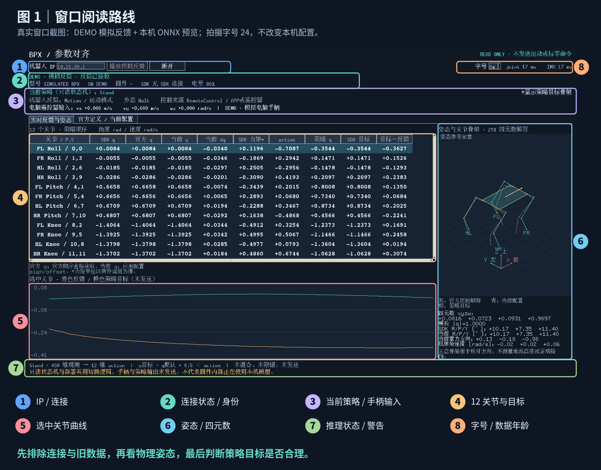

[放大标注图](docs/window_guide/figures/01-overview.png) · [查看未加标注的原始截图](docs/window_guide/screenshots/02-stand.png)

| 图中编号 | 区域 | 先回答的问题 |
|---|---|---|
| 1 | IP 和连接按钮 | 是否连接了计划使用的机器人地址？ |
| 2 | 连接状态和身份 | 当前来源是 SDK、DEMO 还是录制？机型、SN、版本是否符合预期？ |
| 3 | 当前策略、固件状态和遥控器输入 | 状态机选中了哪份模型？手柄输入和固件状态是什么？ |
| 4 | 12 个关节数据 | 是否有有效反馈？关节名、通道和坐标是否对应？ |
| 5 | 选中关节曲线 | 实际角与预览目标随时间怎样变化？ |
| 6 | 骨架、四元数和姿态 | 显示方向是否与真实机身和腿的方向一致？ |
| 7 | 推理状态与警告 | 模型是否成功推理？有没有缺失、过期、越界或加载错误？ |
| 8 | 字号与数据年龄 | 字是否清楚？joint/IMU 是否持续更新？ |

推荐阅读顺序：**1、2、8 → 4、6 → 3、5、7**。连接和新鲜度没弄清楚时，先不要根据策略列判断模型好坏。

## 3. 第一次使用：从打开到读到数据

### 3.1 打开窗口

在项目根目录执行：

```bash
cd /home/hanguang/BPX_test
conda activate bpx-real
python sim2real/visualize.py
```

默认优先使用 `sim2real/config/local.runtime.toml`。显式指定配置的方法：

```bash
python sim2real/visualize.py --config sim2real/config/local.runtime.toml
```

没有连接机器人时，可以先熟悉界面：

```bash
python sim2real/visualize.py --demo
```

DEMO 的关节、姿态和力矩是程序构造的数据；它不会创建 SDK 连接。不要把 DEMO 中的“电量 80%”或模型结果当成实机信息。

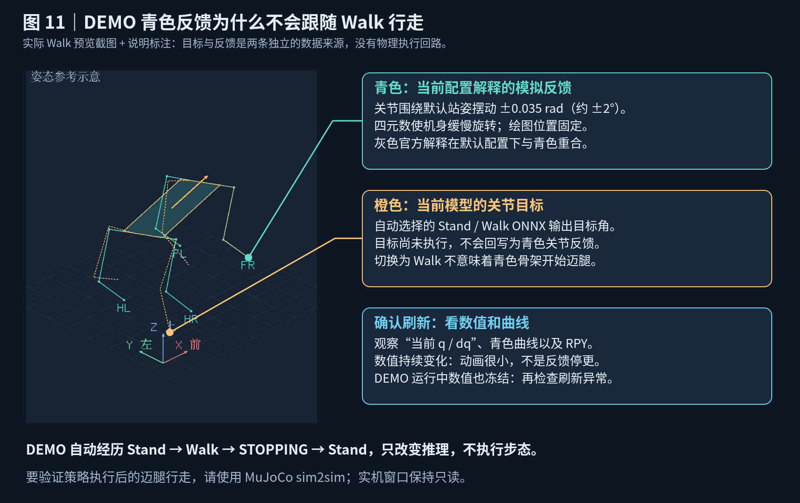

青色骨架的关节只在默认站姿附近摆动约 ±2°，机身缓慢旋转，绘图位置固定。橙色目标没有执行，也不回写模拟反馈，因此自动切换到 Walk 后，青色骨架不会迈腿行走。通过“当前 q / dq”、青色曲线和 RPY 的持续变化判断刷新；DEMO 运行中这些数值也完全不变时，再排查刷新异常。验证策略驱动后的步态使用 [MuJoCo sim2sim](../sim2sim/README.md)。

### 3.2 先认识未连接界面

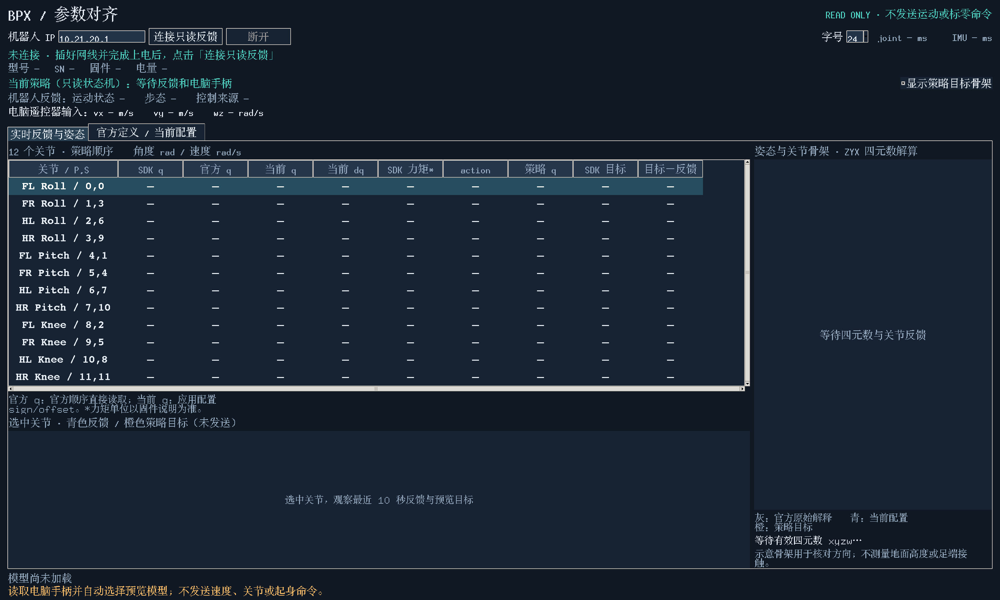

`—` 表示 **当前没有可显示的有效值**，不是数值 0。未连接、反馈没到齐、模型没加载或策略暂停，都可能使部分列显示横线；需结合顶部和底部状态区判断。

### 3.3 网线接入后

1. 按厂商流程完成本体支撑、上电和必要初始化。
2. 电脑有线网卡使用与机器人匹配的地址和掩码。
3. 填写机器人 IP，点击“连接只读反馈”。
4. 先看身份、关节反馈和数据年龄，再看策略列。

官方 SDK 文档给出的默认 RJ45 地址是 `10.21.20.1`；改过地址时使用实际值。Linux 上可先执行：

```bash
ip -br addr
ip route get 10.21.20.1
ping -c 3 10.21.20.1
ss -lunp
```

到机器人的路由应走有线网卡。VPN/代理的 TUN 路由可能截获这个地址。ping 成功仅说明部分网络可达，SDK 的 TCP 订阅和 UDP 反馈仍需分别确认。

真实 SDK 连接开始后，窗口还要观察 joint 和 IMU 各至少两次更新标记变化，才开始预览。只看到一份缓存，或者重复读取同一份缓存，并不能满足这个条件。

### 3.4 字号和滚动

启动默认值为正文、加粗数值 **32 号**，右上可选 12～48。放大后通过横向滚动查看右侧列，通过纵向滚动查看未显示的关节。

希望下次启动仍使用某个字号时，修改本机运行配置：

```toml
[monitor]
font_size = 32
```

界面下拉框只调整当前窗口；不会自动写回 TOML。代码或配置改动对已经打开的旧窗口不生效，需要关闭并重新启动。

## 4. 每一行代表哪个关节

### 4.1 名称和单位

| 标记 | 含义 |
|---|---|
| FL / FR | 左前腿 / 右前腿 |
| HL / HR | 左后腿 / 右后腿 |
| Roll | 髋横滚，腿向侧面摆动的关节 |
| Pitch | 髋俯仰，大腿前后摆动的关节 |
| Knee | 膝关节，小腿屈伸关节 |
| q | 关节角度，rad |
| dq | 关节角速度，rad/s |

腿的左右、前后，以机器人本体方向为准。`1 rad ≈ 57.30°`，`0.1 rad ≈ 5.73°`。dq 为正表示 **模型角 q 在增加**，不能脱离关节轴定义直接解释为“抬腿”或“顺时针”。

### 4.2 P,S 是两套数组的索引

`FR Roll / 1,3` 表示：右前髋横滚在策略数组中是 **P=1**，在当前配置的 SDK 数组中是 **S=3**。索引均从 0 开始。

| 策略 P | 关节 | 官方 SDK S |
|---:|---|---:|
| 0 | FL Roll | 0 |
| 1 | FR Roll | 3 |
| 2 | HL Roll | 6 |
| 3 | HR Roll | 9 |
| 4 | FL Pitch | 1 |
| 5 | FR Pitch | 4 |
| 6 | HL Pitch | 7 |
| 7 | HR Pitch | 10 |
| 8 | FL Knee | 2 |
| 9 | FR Knee | 5 |
| 10 | HL Knee | 8 |
| 11 | HR Knee | 11 |

策略按 **Roll 四个 → Pitch 四个 → Knee 四个** 排列；SDK 按 **FL 三个 → FR 三个 → HL 三个 → HR 三个** 排列。所以 P 和 S 不同是正常现象，不能为了“编号相同”去重排已有模型。

## 5. 一行中的三个 q、速度和力矩

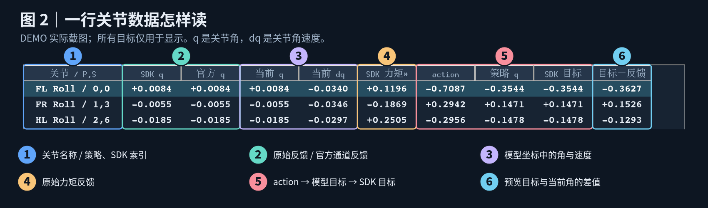

[放大列说明图](docs/window_guide/figures/02-columns.png)

### 5.1 各列准确含义

| 列名 | 实际计算或来源 | 主要用途 |
|---|---|---|
| SDK q | 当前配置 S 通道的原始 SDK 角度 | 看程序当前选中了哪个通道的值 |
| 官方 q | 官方规定通道的原始 SDK 角度 | 与当前选择的通道作对照 |
| 当前 q | `sign × SDK q + offset` | 供模型使用的实际角度 |
| 当前 dq | `sign × SDK 原始关节角速度` | 供模型使用的实际角速度 |
| SDK 力矩* | 当前配置 S 通道的原始力矩反馈 | 查看反馈变化；单位以固件说明为准 |
| action | 当前显示模型的 12 维原始输出 | 看模型希望怎样修正默认姿态 |
| 策略 q | `默认角 + action_scale × action` | 模型坐标下的预览目标角 |
| SDK 目标 | 策略 q 转换回 SDK 坐标 | 检查将来目标转换是否正确，当前未发送 |
| 目标−反馈 | `策略 q − 当前 q` | 查看预览目标与当前状态的差距 |

**“官方 q”也是反馈，不是官方理论角度、默认站姿或仿真值。** 三个 q 不是三次独立测量，而是同一份 SDK 数组的不同通道选择和转换结果。

SDK 力矩列没有乘配置的 sign。它是原始 SDK 值，不能直接当作模型坐标下已经转换好的力矩，更不能根据这个数字推断固件限矩已经生效。

### 5.2 为什么默认三个 q 相同

如果使用官方索引、`sign=1、offset=0`：

```text
SDK q = 官方 q = 当前 q
```

这说明程序没有额外改变该反馈值。它 **不证明实际关节机械零位、轴方向或模型姿态已经正确**。还需要对照物理本体和骨架。

### 5.3 用一个数字例子看映射和方向问题

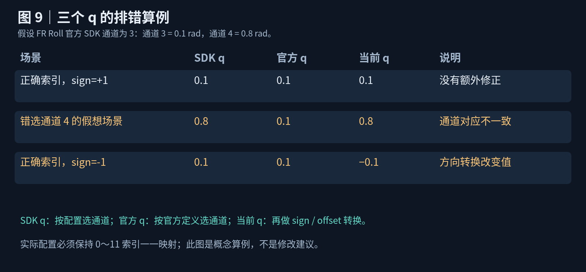

假设 FR Roll 的官方通道 3 返回 `0.1 rad`，通道 4 返回 `0.8 rad`：

| 情况 | SDK q | 官方 q | 当前 q | 能看出的现象 |
|---|---:|---:|---:|---|
| 正确读通道 3，无修正 | 0.1 | 0.1 | 0.1 | 没有额外转换 |
| 错选通道 4，无修正 | 0.8 | 0.1 | 0.8 | 当前读取的通道与官方定义不同 |
| 正确读通道 3，sign=-1 | 0.1 | 0.1 | −0.1 | 符号转换改变了模型角 |
| 正确读通道 3，sign=1、offset=0.05 | 0.1 | 0.1 | 0.15 | 增加了固定偏移 |

这些是教学算例，不是截图里的实测数值。实际配置要求 0～11 的 SDK 索引保持一一映射，重复索引会在加载时被拒绝。

下面是实际窗口对一个 **人为 sign 覆盖** 的显示。截图只在内存中改变 FR Roll 的 sign，没有修改你的本机文件。

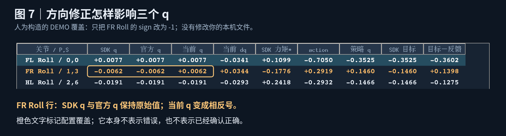

### 5.4 怎样判断需要 sign 还是 offset

| 观察到的关系 | 可能方向 | 需要补充的证据 |
|---|---|---|
| 真实一个关节变化，但对应行像另一个关节 | 通道映射 | 核对官方索引、模型名字和配置索引 |
| 变化幅度接近，但正负与模型相反 | sign 或关节轴约定 | 在允许的受控姿态下核对方向 |
| 多个参考姿态下，角度始终差近似相同常量 | offset 或初始化参考不同 | 核对已知物理姿态和官方零位准备流程 |
| 差值随姿态变化，不是固定常量 | 通道、单位、参考定义或机构差异 | 先查原因，不能用一个 offset 强行消除 |

只有确认不一致后才使用覆盖项。单独看到三个 q 的差异，并不能自动判断哪一方正确；单独看一个未知姿态，也不能可靠计算 offset。

## 6. action、策略 q 和 SDK 目标怎样分析

### 6.1 数据从哪里来

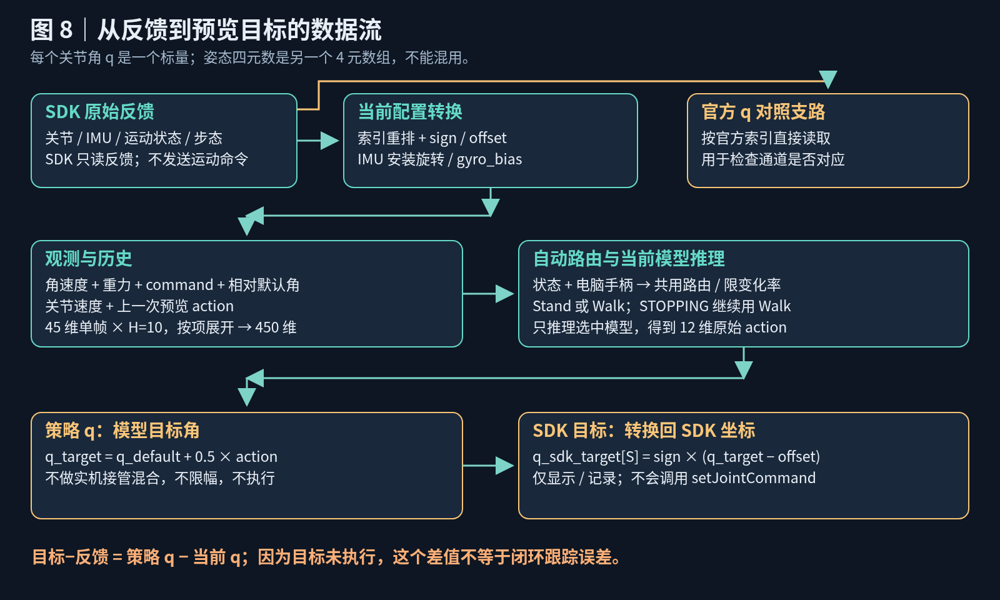

当前工程的策略约定是：

| 项目 | 当前值 |
|---|---|
| 单帧 Actor 观测 | 45 维 |
| 历史长度 | H=10，按观测项分别堆叠 |
| ONNX 输入 / 输出 | `[1,450] → [1,12]` |
| 策略调度 | 50 Hz，约每 20 ms 推理一次 |
| 默认关节角 | Roll 0；Pitch 0.7；Knee −1.4 rad |
| action_scale | 0.5 |

45 维单帧包含角速度、机体重力方向、速度指令、相对默认角的关节位置、关节速度和上一动作。当前 Actor 不使用基座线速度；Critic 的输入不是这个窗口加载模型时的输入。

只推理自动选中的模型，并维护该模型的历史与上一原始 action。首帧填满历史，上一 action 初始为零；策略状态切换、断连、过期和调度明显卡顿时会重建相应历史。

**这是预览动作历史，不是机器人实际执行历史。** 所以它适合检查输入和数值，不能完整复现真机闭环策略轨迹。

### 6.2 用 Pitch 做一次计算

```text
默认 Pitch 角 = 0.7 rad
action         = 0.2
策略 q         = 0.7 + 0.5 × 0.2 = 0.8 rad
```

若 `sign=1、offset=0`，SDK 目标也为 `0.8 rad`。

若 `sign=-1、offset=0.05`，则：

```text
SDK 目标 = sign × (策略 q − offset)
         = −1 × (0.8 − 0.05)
         = −0.75 rad
```

这个反向换算保证读取和目标转换使用同一套坐标约定。方向修正不用于 kp/kd；增益只重排通道。

`action=0` 表示目标等于默认角，不表示电机关闭。原始神经网络输出也不必严格处于 `[-1,1]`；本窗口不会把它自动裁剪到这个区间。

### 6.3 自动策略与电脑遥控器输入

窗口不再提供手动切换模型或填写速度的控件。顶部显示三类信息：

| 显示 | 来源和含义 |
|---|---|
| 当前策略（只读状态机） | 使用 Stand/Walk/STOPPING 预览路由，由反馈有效性和电脑手柄输入自动选择，不执行实机起身状态机 |
| 机器人反馈 | SDK 的运动状态、步态和控制来源；这是固件反馈，不是本机神经网络名称 |
| 电脑遥控器输入 | USB/蓝牙手柄经轴映射、死区和速度范围换算后的 vx/vy/wz，未发送 |

**“当前策略”是本窗口只读状态机选中的预览模型，不是对机器人内部模型权重的识别。** SDK 1.0.9 没有内部神经网络名称或厂商遥控器摇杆反馈接口；电脑手柄输入也不代表固件已经接收这些速度。

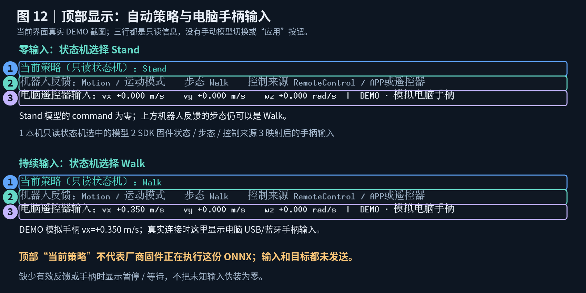

图中两幅裁剪来自当前 DEMO 窗口：上方为零输入时的 Stand，下方为持续输入时的 Walk。编号 1 是本机模型选择，编号 2 是固件状态信息，编号 3 是只读手柄输入；这里没有手动选择或应用指令的控件。

只有反馈完整新鲜、运动状态为 `Motion=6`、步态为 `Walk=0`，且电脑手柄可读时，才开始自动选择模型。`StandingUp=1` 是起身状态，不能直接当成 Stand 模型已执行；趴卧、起身、阻尼、趴下、未知状态及其他步态时暂停策略列，保留反馈和姿态。

| 只读状态机阶段 | 自动选择和模型输入 |
|---|---|
| Stand | 手柄保持零或低输入时，选择 Stand，模型 command 恒为零 |
| Walk | 持续输入超过进入阈值后，选择 Walk，使用限制变化率后的手柄输入 |
| STOPPING | 松开摇杆并满足退出延时后，继续使用 Walk，逐步回到零 command；过渡结束后回 Stand |
| 暂停 / 等待 | 无手柄、反馈过期、状态不适用或倾角超限，不显示当前策略目标 |

当前模板按 `max(abs(command)/command_limit)` 衡量输入强度：进入阈值 0.12、持续 0.15 s；退出阈值 0.05、持续 0.30 s；最短 Walk 时间 0.30 s，STOPPING 1.5 s。预览参数在 `[control]`，窗口使用简化路由及 command 限变化率。实机入口与 sim2sim 共用完整 Supervisor，另按实测速度连续稳定判定 STOPPING 完成，并支持 WAITING_INIT/INIT。窗口不执行这些验收、关节接管、动作混合或目标保护。

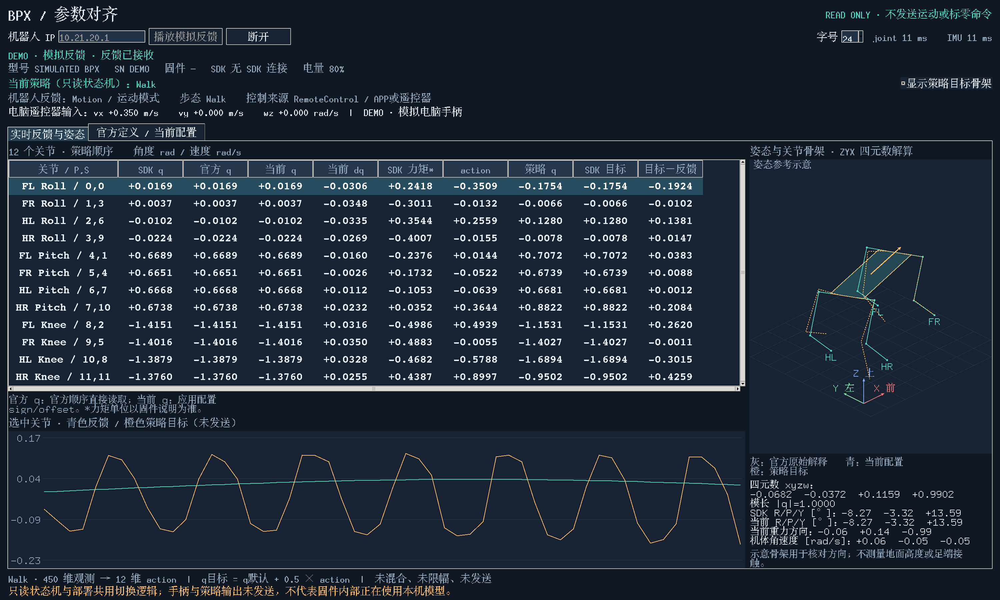

| 输入 | 默认手柄轴 | 含义 / 单位 |
|---|---|---|
| vx | 左摇杆上下 | 机体 X 轴期望线速度，m/s |
| vy | 左摇杆左右 | 机体 Y 轴期望线速度，m/s |
| wz | 右摇杆左右 | 绕机体 Z 轴期望角速度，rad/s |

默认沿用 MuJoCo 手柄映射，死区 0.1，范围 `[1.0,0.5,1.0]`。具体手柄轴方向需核对。顶部显示映射后的实时输入，模型的实际 command 还经过状态机和变化率限制，两者在切换过程中可以不同。

手柄使用 Linux `/dev/input/event*` 只读接口；单个设备自动选择，多个设备需指定。窗口不独占手柄，也不调用机器人控制接口。

```bash
python sim2real/visualize.py --list-gamepads
python sim2real/visualize.py --gamepad-index 0
# 或按列表中的实际设备路径指定
python sim2real/visualize.py --gamepad-device /dev/input/eventN
```

没有手柄时显示 `—` 和原因，不把未知输入填为零；读权限不足时会显示权限错误，需要先让当前账号能正常读取该设备。拔出手柄后自动暂停，重新可读后重新建立预览历史。DEMO 使用明确标记的模拟手柄，按预设时间自动经历 Stand→Walk→STOPPING→Stand，不读取电脑真实手柄。

### 6.4 “目标−反馈”为什么不要求为零

假设当前 Pitch 为 `0.75 rad`，策略 q 为 `0.8 rad`：

```text
目标−反馈 = 0.8 − 0.75 = 0.05 rad ≈ 2.86°
```

这表示模型目标与收到的状态不同。窗口没有发送这个目标，因此机器人没有义务向它靠近。

不要根据差值较大，直接认定电机跟踪差、kp 太低或 offset 错误。更有用的问题是：**当前姿态是否适合这份模型？观测是否正确？模型目标是否在合理范围？**

### 6.5 输出合理性的检查

| 检查项 | 解释 |
|---|---|
| action / 目标是否有限 | NaN/Inf 或维度错误会使对应模型输出停用，并显示错误 |
| 目标是否超模型范围 | 超出当前配置范围时，该行红色并有警告 |
| 同一姿态、同一模型下是否持续异常跳变 | 结合反馈、模型输入、历史重建和 command 变化分析 |
| 是否拿站立模型分析完全不适合的姿态 | 趴卧、大幅倾斜等状态可能超出模型熟悉的分布 |
| 使用的文件是否是计划部署的导出 | 核对参数页路径及 `check` 输出的 SHA-256 |

窗口显示的是未混合、未限幅的策略目标。红色提示是诊断证据，不是窗口已经执行了危险动作；模型范围来自 URDF/覆盖项，也不等同于实机安全工作范围已验证。

## 7. 四元数、RPY、重力和三维骨架

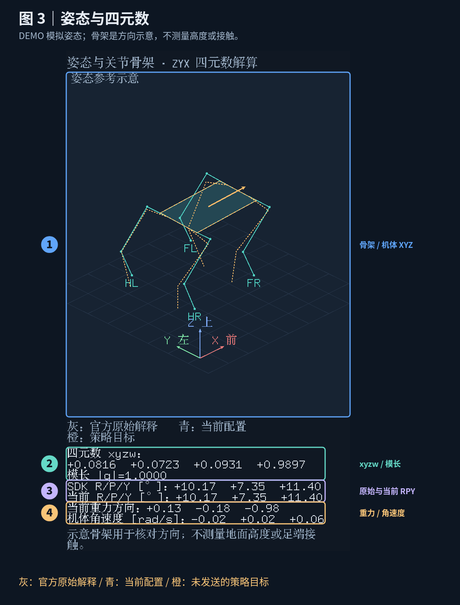

[放大姿态图](docs/window_guide/figures/03-attitude.png) · [原始姿态截图](docs/window_guide/screenshots/02-stand-attitude.png)

### 7.1 三种颜色的骨架

| 颜色 | 显示内容 |
|---|---|
| 灰色 | 原始 SDK 四元数按机体→世界解释，关节按官方顺序直接读取 |
| 青色 | 应用当前关节与 IMU 配置后的机体、腿姿态 |
| 橙色 | 当前选择模型的目标关节角，使用当前机体姿态画出，尚未执行 |

默认没有坐标修正时，灰色和青色会重合，灰色可能被遮住。橙色不必重合，它代表模型的目标。

骨架使用官方 URDF 的连杆尺寸。坐标方向为 **X 前、Y 左、Z 上**。箭头和腿名用于核对方向；脚画得靠近网格不代表真实接触地面，画出的机体位置也不是实际距地高度。

### 7.2 四元数 xyzw

这是描述机体三维旋转的四个数：`[x,y,z,w]`。它与关节角 q 是不同数据：关节 q 是每关节一个角，姿态四元数是整体姿态的四元数组。

水平且世界参考方向一致时可能看到 `[0,0,0,1]`，但不能要求每次开机都等于这个数组。水平机身也可以有不同 yaw。

`|q|` 是四元数模长，通常应接近 1。当前程序允许原始模长在 `[0.9,1.1]` 内，然后归一化计算旋转；这是软件数值检查，不是厂商姿态精度验收标准。

四元数 `q` 与 `−q` 表示同一个旋转。如果四个分量一起反号，但骨架和 RPY 基本不变，不能仅凭分量跳变认定 IMU 翻转。

### 7.3 SDK R/P/Y 与当前 R/P/Y

| 名称 | 实际来源 |
|---|---|
| SDK R/P/Y | **本窗口从原始四元数解算**的 ZYX 欧拉角，不是另一次调用 SDK RPY 接口的独立测量 |
| 当前 R/P/Y | 采用 `quaternion_frame` 和安装旋转配置后，再解算出的 ZYX 欧拉角 |

单位为度。Roll、Pitch、Yaw 分别表示绕 X、Y、Z 轴的旋转；正负需结合右手定则和已知物理姿态核对，不要只凭“抬头”“顺时针”猜方向。

yaw 从 `+179°` 跳到 `−179°` 可能只是角度跨过 ±180°。Pitch 接近 ±90° 时 Roll/Yaw 不唯一；这种情况下优先看四元数和旋转骨架。

### 7.4 当前重力方向

窗口使用姿态计算模型机体系下的归一化重力方向：

```text
gravity_body = R_body_to_worldᵀ × [0,0,−1]
```

它没有单位，模长约为 1。它不是加速度计原始的 m/s² 读数。

| 数学参考姿态 | 理想重力方向，近似值 |
|---|---|
| 水平；任意纯 yaw | `[0,0,−1]` |
| 按当前右手旋转约定 roll=+10°、pitch=0 | `[0,−0.174,−0.985]` |
| 按当前右手旋转约定 pitch=+10°、roll=0 | `[+0.174,0,−0.985]` |

这些是坐标数学算例，不是让机器人执行的姿态命令。界面分量只显示两位小数，显示值合成的模长可能因四舍五入略偏 1。

### 7.5 机体角速度与 gyro_bias

窗口按以下配置计算模型使用的角速度：

```text
omega_body = sensor_to_body × (omega_sdk − gyro_bias)
```

框架按 rad/s 使用这些值，SDK/固件反馈需符合这个单位约定。静止时应接近零，但不要因单次非零值就重写 bias；先检查是否真的静止、是否新鲜以及是否已有固件补偿。

### 7.6 实际核对方法

先在允许的水平静止状态下，检查重力接近 `[0,0,−1]`、角速度接近零，再用小幅、已知方向的倾斜核对轴和正负。

仅通过水平检查，不能确认所有方向，尤其不能确认 yaw。人工改变姿态/关节只在厂商允许且本体支撑可靠的条件下进行，不强扳有保持力矩的关节。

原始解释正确、当前解释错误时，先检查是否重复增加安装旋转或 bias；两者都不符合物理姿态时，再核对接口含义和固件坐标。`sensor_to_body` 必须是正交、行列式 +1 的旋转矩阵，不能通过随意翻转一个轴构造镜像。

## 8. 数据年龄和颜色怎样读

### 8.1 joint / IMU 后面的 ms

年龄表示：**主机看到该组更新标记变化后，已经过去多久**，界面还会计入展示后的时间。

它不是机器人到电脑的端到端网络延迟，不是电机控制周期，也不是实际 UDP 发包频率。数值为零也不能单独证明缓存来自最新一次机器人采样。

| 现象 | 如何理解 |
|---|---|
| 角度不变，但年龄持续保持较小 | 可能是正常静止反馈；更新标记仍在变化 |
| 年龄不断增大 | 缓存没有观察到新的更新，或会话/展示已停止 |
| joint 小、IMU 大 | 优先检查 IMU 数据组和更新时间 |
| 两者小，但策略列仍为空 | 还要检查字段完整性、更新标记、模型加载和错误提示 |

当前模板的 `max_state_age_s=0.10`，即 100 ms；`max_group_skew_s=0.05`，即各组主机观察到的更新时间差不超过 50 ms。它们是当前软件阈值，需要根据真实反馈和时序分析，不是 BPX 所有固件的统一验收参数。

### 8.2 行颜色和骨架颜色

| 显示 | 含义 |
|---|---|
| 表格灰色 | 关节反馈过期、连接/会话停用等；可能仍保留旧角度 |
| 表格橙色 | SDK 索引、sign 或 offset 与官方默认不同 |
| 表格红色 | 所选模型目标超出当前配置的模型范围 |
| 青色选中背景 | 当前选择的关节，用于下方曲线；不表示验收通过 |
| 姿态示意变灰 | IMU 过期、会话结束或连接失效等 |

一个组过期时，不保证所有图形同时变灰。以数据年龄和状态提示为主要证据，不只看颜色。

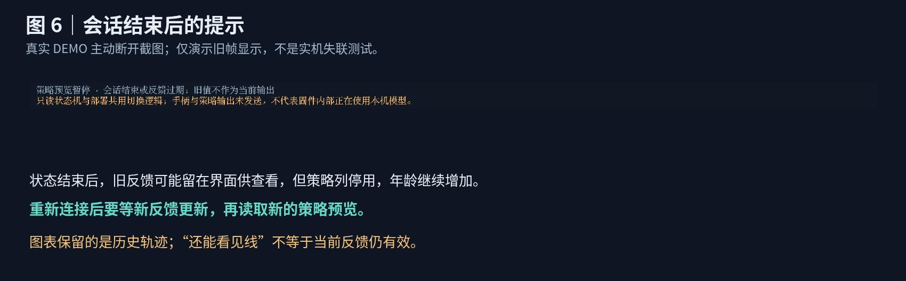

图 6 是 **主动断开 DEMO** 后的真实显示，用来理解旧帧状态，并非实际网线失联测试。历史曲线仍留在屏幕上，不代表当前还有有效反馈。

## 9. “官方定义 / 当前配置”页该比较什么

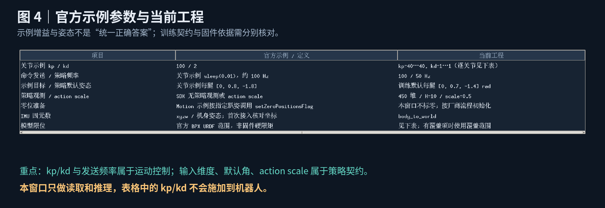

[查看完整参数页](docs/window_guide/screenshots/04-parameters.png)

| 项目 | 图中对照 | 应怎样判断 |
|---|---|---|
| kp / kd | 官方关节示例 100/2；当前训练/配置 40/1 | 两套值不同不自动构成错误；窗口不施加这些增益 |
| 命令发送 / 策略频率 | 模板发送 100 Hz，策略 50 Hz | 两者是不同调度；只读窗口不发送关节命令 |
| 示例目标 / 默认姿态 | 官方关节示例 `[0,0.8,−1.8]`；当前默认 `[0,0.7,−1.4]` | 示例目标不是必须套用的策略默认角 |
| 观测 / action scale | 450 维、H=10、scale=0.5 | 必须与这份已训练模型匹配 |
| SDK 索引 | 官方与当前配置 | 普通接入按官方定义，不重新猜通道 |
| sign / offset | 默认 1/0；覆盖项标橙色 | 确认原因后才修正，不为了消除目标差值而调整 |
| 当前模型范围 | 默认来自官方 URDF 或覆盖项 | 不等同于固件限矩、限速或实机可用范围已确认 |
| 模型路径 | Stand / Walk 的具体导出文件 | 不会自动切换到新训练的模型，改路径后需重启 |

默认模型范围按关节类型为：

| 类型 | 模型范围，rad |
|---|---|
| Roll | `[−0.8727, +0.8727]` |
| Pitch | `[−0.7854, +2.60661]` |
| Knee | `[−2.7531, −0.5539]` |

SDK 本身不定义你的 Actor 的 action_scale。不要因为官方另一个训练项目使用不同缩放，就覆盖当前模型的 0.5。

## 10. 曲线怎么分析

先点击一行关节。下方画该关节最近约 10 秒的数据：**青色为当前 q，橙色为策略 q**。选择别的关节或自动选中的模型发生变化时，曲线会重新开始记录；手柄输入持续变化会保留在曲线中。

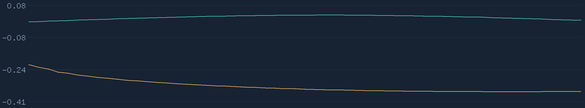

| 曲线现象 | 优先分析 |
|---|---|
| 青线近乎水平，橙线与它不重合 | 在只读预览中正常；机器人没有执行橙色目标 |
| 青线缓慢变化 | 对照本体是否移动、初始化是否完成、数据是否有效 |
| 青线明显跳变 | 查原始 SDK q、更新标记和会话；排除真实动作、通道或单位问题 |
| 同一模型的橙线持续异常跳变 | 查观测、IMU、command、模型契约和历史重建 |
| 自动切换 Stand/Walk 后目标差异明显 | 两份模型输出不同，且预览没有部署混合；不能单凭此判故障 |
| 断开后图中仍有线 | 是已有历史，不是正在运行的反馈或控制 |

判断抖动时保持同一模型、同一 command 和可复现物理姿态，查看原始录制，避免把切换或输入变化混在一起。窗口没有提供闭环性能统计或稳定性合格公差。

## 11. 常见问题：按现象查原因

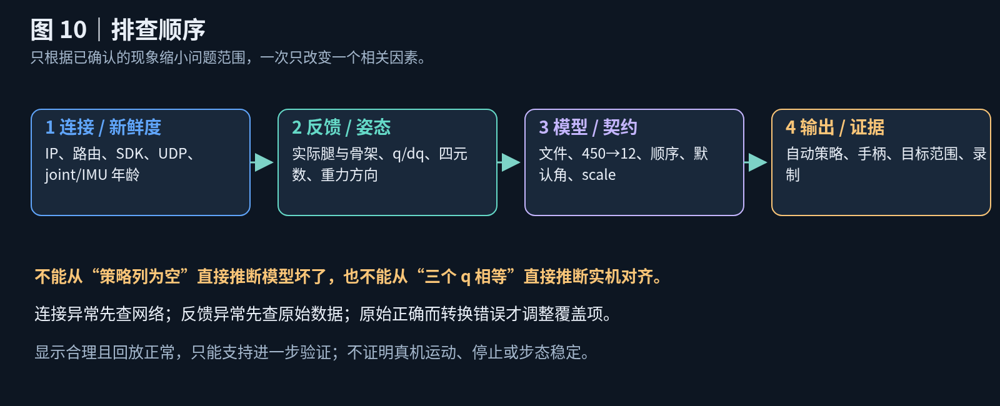

### 11.1 所有反馈和策略列都是横线

先看是否未连接。若点击连接后仍为空，按以下顺序排查：

1. IP、上电状态和厂商规定的接入条件。
2. 有线网卡地址、掩码和 `ip route get` 的实际路径。
3. TCP 是否建立、是否报连接超时。
4. 本地 UDP 9873 是否被占用，防火墙和回程是否正常。
5. SDK/固件兼容，以及该固件是否提供需要的状态和时间戳字段。

不要把未上电、TCP 可达或重复读取旧缓存解释成已收到有效反馈。只读窗口不需要开启 `allow_motion`；把它改为 true 不能修复通信问题。

### 11.2 q/dq 有值，但 action 和策略目标都是横线

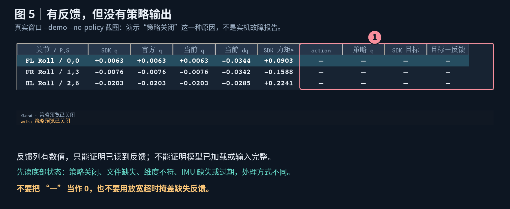

图中是明确的 `--no-policy` 示例。真实使用中还可能有以下原因：

| 底部提示或现象 | 检查/处理 |
|---|---|
| 无手柄、设备权限错误、状态不适用 | 看顶部原因，确认电脑手柄可读及固件状态；无需手工填写速度 |
| 策略预览已关闭 | 是否使用了 `--no-policy`；需要预览时重新启动并去掉该选项 |
| 找不到 ONNX 文件 | 在参数页和 `check` 中核对实际路径、相对路径基准 |
| 模型维度不匹配 | 两份模型均应符合配置；当前为 `[1,450]→[1,12]` |
| 没有 ONNX Runtime | 确认使用 bpx-real 解释器及其安装依赖 |
| 等待完整/新鲜反馈 | 检查 dq、四元数、角速度、更新标记和年龄；有 q 不代表其余字段完整 |
| 等待两次更新 | 等待新标记；若一直不满足，查反馈通道和固件支持 |
| 数据已过期 / 组时间差过大 | 查实际卡顿和 UDP 更新，先定位原因，不直接放宽阈值 |
| Actor 输出无效、NaN/Inf | 保存原始输入和模型信息，核对观测与模型，暂停运动部署 |

查看当前文件和依赖：

```bash
python sim2real/run.py --config sim2real/config/local.runtime.toml check
```

当前窗口只推理自动选中的模型。停留在 Stand 时没有 Walk 输出是正常现象；只有状态机进入 Walk 后仍为空，才结合模型错误和手柄/反馈状态排查。

### 11.3 三个 q 相同，但骨架与真实姿态不一致

三个 q 相同只表示未修正，不能证明官方反馈与当前物理姿态、模型参考角对应。检查初始化/零位准备是否完成、模型是否为 BPX、单位是否一致，以及实际物理姿态是否可复现。

不要把上电时的任意姿态定义成所有关节 q=0，也不要用策略目标减反馈直接计算 offset。

### 11.4 SDK q 与官方 q 不同

这说明当前配置选择的通道与官方通道不同，或者正使用有意的通道覆盖。先到参数页核对索引。因为两列来自同一份数组，这个差异通常不应直接归因于网络采样延迟。

真实关节移动与哪一行变化之间的关系仍需核对。若必须更改映射，应保持全体索引一一对应，重新启动后验证。

### 11.5 SDK q 与官方 q 相同，但当前 q 不同

优先查看 sign 和 offset。若差异由已确认的坐标转换造成，可以正常；若没有这项需求，检查是否误用了覆盖项。原始值正确而转换值不正确时，先修复覆盖配置，不改机器人固件标零。

### 11.6 姿态朝向不对、重力方向不对

| 现象 | 优先核对 |
|---|---|
| 四元数模长异常、全零或缺失 | 数据有效性、SDK 字段；暂不分析骨架朝向 |
| 水平时 g 明显不接近 `[0,0,−1]` | 实际水平程度、四元数方向含义、安装旋转 |
| 灰色看起来正确，青色反而错误 | 当前 IMU 覆盖是否多做或做错转换 |
| 静止角速度长期偏离零 | 真正静止、单位、更新情况和已有固件补偿 |
| 只看到 yaw 不为零 | 不一定有问题；世界初始航向并不要求为零 |
| 所有四元数分量一起反号 | 看旋转是否连续，q 与 −q 可能等价 |

一次只核对一个轴或一个转换因素，保留原始四元数和 omega。水平姿态通过后，再看已知倾斜，不直接猜旋转矩阵。

### 11.7 策略目标超范围，或差值很大

先核对真实姿态是否适合所选策略，再查关节排列、IMU、默认角、action_scale、历史和模型文件。当前默认 Pitch 0.7/Knee −1.4 是动作零点，不是任何反馈都必须等于的值。

目标没执行时，较大差值不能用于调 kp/kd。不要为了让红色消失盲目扩大范围或减小 action_scale；这些修改会改变部署行为，甚至破坏训练契约。

### 11.8 断开、录制结束或数据长期过期

旧反馈可能继续以灰色留在界面，策略列停用，历史线保留。先看状态是否为主动断开/录制结束；真实失联时核查电源、线缆、TCP 与 UDP。

当前只读 SDK 可能自动重连，重连/会话变化时预览历史会重建。即使预览恢复，也不表示任何运动控制恢复；本窗口从未发送策略目标。

## 12. 保存记录，再复查同一个问题

### 12.1 保存窗口反馈与预览

```bash
python sim2real/visualize.py \
  --config sim2real/config/local.runtime.toml \
  --output outputs/sim2real/monitor-01.jsonl
```

文件以排他方式创建，不覆盖旧数据。再次开始会话时换新文件名；同一输出文件不能重复开启连接。

记录包含配置快照、原始反馈、电脑手柄输入、自动状态机信息 `control` 和 `preview`。每帧仅保存当前选中模型的 action、模型目标、SDK 目标、模型实际使用的 command 和超范围关节名；暂停时没有当前策略结果。

### 12.2 回放和分析

```bash
# 显示已录制的原始反馈，重新计算预览；不连接 SDK。
python sim2real/visualize.py \
  --config sim2real/config/local.runtime.toml \
  --recording outputs/sim2real/monitor-01.jsonl

# 分析原始反馈统计，不分析 preview 的闭环性能。
python sim2real/run.py --config sim2real/config/local.runtime.toml analyze \
  outputs/sim2real/monitor-01.jsonl
```

窗口回放使用 **当前加载的配置和模型重新推理**，不是原样播放旧 `preview`。复现旧结果时保留原配置和模型，核对 SHA-256；旧 preview 可直接在 JSONL 中查看。

旧的 inspect 录制如果不包含电脑手柄输入或运动状态年龄，窗口仍显示反馈和姿态，但不会猜测 command 或策略。新窗口录制可按已保存输入重新运行状态机。窗口保留大倾角姿态示意，但超过 `max_tilt_rad=0.45` 时暂停策略；严格 CLI 回放也有独立保护检查。

### 12.3 每次问题记录最少保存什么

| 内容 | 为什么需要 |
|---|---|
| 原始 JSONL | 区分真实反馈、缓存停更和模型输出 |
| runtime 与坐标配置副本 | 确认索引、sign/offset、IMU 和模型路径 |
| 模型 SHA-256 | 确认用的是同一个导出文件 |
| 当前模型、vx/vy/wz、发生时刻 | 复现输入条件 |
| 本体参考姿态照片或说明 | 判断骨架与实际方向是否对应 |
| 状态区截图 | 保留连接来源、年龄和错误信息 |

配置或模型改动后重启窗口。比较两次结果时，一次只改变一个相关因素；不要同时改映射、增益、默认角和模型文件。

## 13. 看完窗口后，可以得出什么结论

| 证据 | 可以支持的结论 | 还不能证明 |
|---|---|---|
| 身份正确，反馈持续更新 | SDK 接入和部分数据通路可用 | 命令发送、固件看门狗与急停已验收 |
| 物理姿态与骨架对应 | 当前观察范围内的坐标解释合理 | 所有关节全范围、所有上电状态都已验证 |
| 三个 q 相同 | 使用同一通道且未增加修正 | 机械零位和方向已经正确 |
| 模型加载、输出有限 | 软件观测与推理链路可运行 | 实机步态稳定、目标可安全执行 |
| 没有越界警告 | 当前目标没有触发配置模型范围检查 | 固件硬限矩、硬限速或实际安全范围正确 |
| 录制回放可复现 | 已保存条件下的软件结果可核查 | 闭环运动性能已验证 |

确认对齐后，才考虑在本机坐标文件中设置一次 `[alignment].verified=true`。不因为默认值相同或 DEMO 能运行，就把它当作通过。

实际运动还需要独立确认增益、控制权接管、固件保护、限位与退出行为。详细部署条件见 [操作手册](OPERATION_GUIDE.md)。本窗口没有自动起身或运动停车功能。

## 14. 一页速查

| 如果你看到…… | 先做…… |
|---|---|
| 所有列 `—` | 看连接状态，再查 IP/路由/TCP/UDP |
| q 有值，action `—` | 看底部错误；检查模型与完整 IMU/速度反馈 |
| joint/IMU 年龄持续增加 | 查该数据组是否更新，不先扩大超时 |
| SDK q ≠ 官方 q | 查配置通道是否偏离官方索引 |
| 原始角正常，当前角异常 | 查 sign/offset，而不是直接重做固件标零 |
| 两种反馈解释都不符合本体 | 查模型、初始化、单位和接口定义 |
| 灰色姿态正常，青色姿态异常 | 查 IMU 转换是否重复或方向错误 |
| 青线不追橙线 | 只读窗口未发送目标，这是预期 |
| 目标红色或差值大 | 查姿态、输入和训练契约，不用差值调增益 |
| 字小或列没显示全 | 用字号选项和滚动条；启动默认值在 `[monitor]` |

## 15. 对应实现与官方依据

| 内容 | 对应文件 |
|---|---|
| 窗口、表格、颜色、绘图和连接线程 | [monitor.py](bpx_sim2real/monitor.py) |
| 三个 q、姿态解算、自动策略预览 | [diagnostics.py](bpx_sim2real/diagnostics.py) |
| 关节和 IMU 坐标转换 | [calibration.py](bpx_sim2real/calibration.py) |
| 默认映射、模型范围、就绪检查 | [config.py](bpx_sim2real/config.py) |
| 电脑手柄读取 | [monitor_input.py](bpx_sim2real/monitor_input.py)、[公共手柄接口](../bpx_runtime/gamepad.py) |
| 只读 Stand/Walk/STOPPING 预览路由 | [routing.py](../bpx_runtime/routing.py) |
| SDK 缓存读取与年龄计算 | [sdk_robot.py](bpx_sim2real/sdk_robot.py) |
| 状态和实际运动目标保护 | [safety.py](bpx_sim2real/safety.py) |
| 已有策略顺序与默认角 | [公共关节定义](../bpx_runtime/joints.py) |
| 官方 JointIndex/kJointNames | [本地 SDK 头文件](../bpx_sdk_open-master/include/motion_types.h) |
| 官方关节控制示例 | [本地 SDK 示例](../bpx_sdk_open-master/example/joint_level_control_example.py) |
| 官方模型轴、尺寸、范围 | [本地 URDF](../source/BPX_test/BPX_test/BPX_structure/bpx/urdf/bpx.urdf) |

在线官方入口：[BPX SDK](https://github.com/mirrormerobotics/bpx_sdk_open)、[BPX 模型](https://github.com/mirrormerobotics/BPX)。本文描述当前工程的窗口实现；厂商初始化和固件实际行为以相应版本说明为准。

## 图片文件说明

`docs/window_guide/screenshots/` 保存未添加标注的原始窗口截图与区域位置记录；`docs/window_guide/figures/` 保存编号标注图和代码绘制的数据流示意图，包含 PNG 和可编辑 SVG。

截图仅来自未连接界面或 DEMO。方向覆盖图只改变拍摄进程中的对象，未写入你的坐标配置；会话结束图来自主动断开 DEMO，不是实机失联实验。分享本文时，请同时携带 `docs/window_guide/`，或使用完整压缩包，避免图片链接失效。
